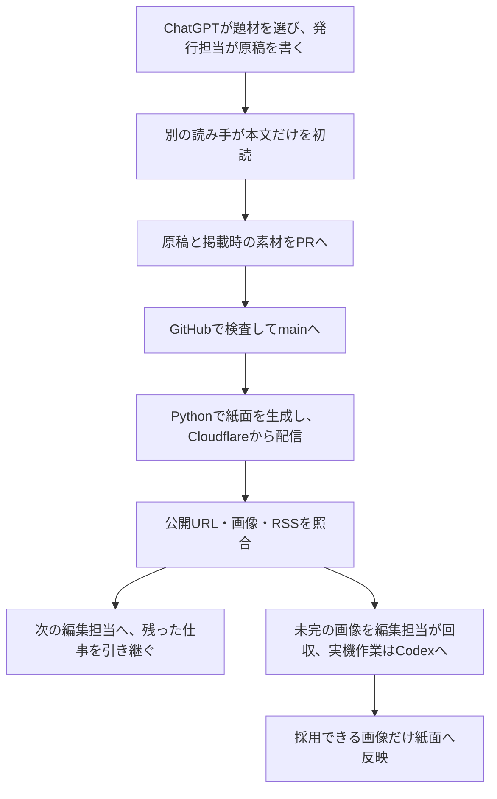

盤上に駒が一つでもあったら、この写真は使えない。

未発生新聞のスポーツ面に、パズルの決勝で部品を一枚も置かずに優勝した選手が登場しました。架空の話です。ところが、記事用に生成した写真には、チェスのような駒がいくつも並んでいました。一見すると立派な大会写真です。これを載せたら、見出しよりも写真のほうが雄弁に、別の出来事を伝えてしまう。

そこで紙面に載ったのは、白黒のマスを数えられる一枚の図でした。[実際のスポーツ面](https://veripsa.com/articles/unsolvable-ai-puzzle-cup-zero-pieces-wins/)

未発生新聞は、現実の話題から「5年後にこんなことが起きたら」と考えて作る、個人運営の創作新聞です。2026年11月9日から15日まで、掲載日時で数えると毎日7本、計**49本**の記事が並びました。題材探しから公開後の点検までの多くを、ChatGPTのスケジュール、Codex、GitHub Actionsが分担しています。

AIで何かを作ったあと、翌朝また自分がチャットを開き、「昨日の続きを」と説明する。その仕事はどこまで減らせるのか。逆に、任せた仕事が本当に終わったか、何を見ればわかるのか。スポーツ面の一本と、編集部が動いた一日の記録を開いてみます。

## 9時30分のスポーツ面が、読者に届くまで

**題材を拾う。** 起点は、日本パズル協会が案内した実在の早解き大会です。ここから「速く解く人に点が入る」を「解けないと証明した人にも点が入る」にひっくり返す。協会の案内は出典に、架空の大会名、選手、勝敗は創作に属します。原稿データにはその境目も残ります。[大会の案内](https://www.jpuzzle.jp/2026/09/tokyo-puzzle-day-2026/)・[記事データの固定版](https://github.com/RollNuts/mihassei-news/blob/8e0f30b2da698c46f5ba15f1d082cb3ec0481f11/content/articles.json)

**別の読み手に渡す。** 初稿には「AIが別々の課題を作り」とありました。一試合ごとに問題が変わるのか、同じ試合の二人が違う問題を解くのか。後者だと勝負の公平さが気になり、肝心のパズルに集中できません。初めて読む担当の指摘を受けて、「試合ごとにAIが新しい課題を作り」と直しました。初読担当に渡すのは見出し、要約、本文。執筆中の相談や「ここを面白がってほしい」という答えを渡さないのが工夫です。[発行時の修正記録](https://github.com/RollNuts/mihassei-news/pull/782)・[編集手順](https://github.com/RollNuts/mihassei-news/blob/8e0f30b2da698c46f5ba15f1d082cb3ec0481f11/docs/EDITORIAL_LOOP.md)

**出したものを確かめる。** この一本の時計を並べると、予定から掲載確認までに何が起きたかが見えます。すべて日本時間です。

| 11月16日の時刻 | 残っている記録 |
| --- | --- |
| 09:30 | 発行予定枠。ChatGPTの発行担当には、この枠でスポーツ面を扱った履歴がある |
| 09:58:57 | 記事データに記録した掲載日時。RSSにもこの時刻が載る |
| 10:07:54 | 原稿を載せたPRがmainに取り込まれた |
| 10:12:26 | この版の本番配信検査が成功して終了した |

RSSの時計では09:58でも、その時刻にはまだPRが統合されていません。最初の読者が何時何秒に読めたのかまでは分かりません。さらに、記事に登場する選手が優勝したのは物語の中の**2031年11月16日**。これをRSSに入れると、5年先の記事を今日配ってしまいます。[発行PR](https://github.com/RollNuts/mihassei-news/pull/782)・[本番検査](https://github.com/RollNuts/mihassei-news/actions/runs/43784420246)・[新聞のRSS](https://veripsa.com/feed.xml)

**公開後、写真を見送って図を載せる。** 5×5の市松模様に、黒が13マス、白が12マス。白を一つ残す指定なので、埋めるのは黒13・白11です。隣り合う2マスを覆う部品は、どこに置いても黒と白を一つずつ使います。12枚なら黒12・白12。どう置いても合いません。空の盤面で勝てる理由を伝えるには、選手の表情より、二組の数を見比べられるほうがいい。後から回収できた写真は、駒が写っていたので不採用。12:13に取り込まれた別のPRで、比較できる図を追加しました。本文にはSVG、リンクを共有したときにはPNGが出ます。[図を追加した変更](https://github.com/RollNuts/mihassei-news/pull/787)・[画像の採否を記した編集メモ](https://github.com/RollNuts/mihassei-news/blob/8e0f30b2da698c46f5ba15f1d082cb3ec0481f11/docs/DAILY_EDITORIAL_BRIEF.md#L39)


## ChatGPTのスケジュールに何を任せているか

サイトを作る一回の仕事は、わりと頼みやすい。「この原稿からページを作って」で始められます。毎日の新聞で面倒なのは、明日の担当に何を渡すかです。今の構成はこうなっています。



11月16日にChatGPTの「アクティブ」一覧を読み、新聞の運用表と写真特集の名簿に照らすと、**新聞に対応づけられたスケジュールは16件**ありました。内訳は下表の9件と、写真素材を制作する7件です。これは登録されている仕事の数です。発行担当一つが日に何度も起動する一方、週次の担当が休んでいる日もあります。

| ChatGPTの担当 | いつ動く設計か（JST） | 次に渡すもの |
| --- | --- | --- |
| 題材探し・品質改善 | 毎朝05:45 | 前日の記事を読み返し、伝わりにくかった点と次の候補を編集メモへ |
| ニュース発行 | 07:30〜23:30、2時間ごと | 原稿、記事用画像、発行記録。通常は最初の7枠、最後の2枠は回収や強い企画に使う |
| 公開後レビュー・画像回収 | 07:55〜翌00:55の毎時、計18枠 | 新着・改稿・初読待ちを点検し、必要なら同じPRで修正する |
| 週次編集・成長判断 | 月曜04:30 | 先週の結果を踏まえ、次週に変えることを一つ決める |
| サイト日次改善 | 水曜を除く毎日02:15 | 表示・操作の不具合や、担当が決まっている未完了作業の修復 |
| 週次SEO・UX改善 | 水曜02:15 | その日の日次改善に代わり、検索導線や主要ページを横断して確認 |
| 写真特集の編集・公開 | 毎日03:30 | 当日の一人分の素材とコラムを週刊号に追加する |
| 未来相場観測室 | 平日08:30・09:40・12:40・15:50 | 観測した時刻と予測の条件を残し、後から同じ記録に結果を追記する |
| 記事紹介の配信監視 | 毎日11:40・17:40・22:40 | 配信漏れや文面の異常を点検。実際の送信は別の処理が担う |

写真特集では、**架空のモデル7人に一つずつ素材制作の予定**があります。素材を受け取る編集担当は、日曜から土曜の担当を割り当て、一人につき写真10枚とコラムを掲載します。編集担当まで画像を生成し始めると、同じ特集の素材を二重に作ってしまい、どちらを採用したか分からなくなる。制作と掲載の仕事を切った理由がここにあります。[公開の運用表](https://github.com/RollNuts/mihassei-news/blob/8e0f30b2da698c46f5ba15f1d082cb3ec0481f11/docs/OPERATIONS.md)・[特集の名簿と掲載データ](https://github.com/RollNuts/mihassei-news/blob/8e0f30b2da698c46f5ba15f1d082cb3ec0481f11/content/photo_issues.json)

Codexには、08:10〜翌00:10の2時間ごと、1日9枠の運用総括・画像補完があります。写真を置く場所にファイルを保存できない、実機で表示を確かめる必要がある、といった引き継ぎが対象です。何も渡されていない回は作業を増やさず終了します。執筆・初読・誌面作成には普通のChatGPTが入っており、毎記事をCodexでもう一度作る工程はありません。

新聞の外側にも仕事があります。掲載済みの記事紹介は、GitHub Actionsが一日最大7枠を扱い、直近の実送信と重複を確認してBufferへ渡します。GPTの仕事はその監視です。朝の手動投稿用の文案、夜の振り返りも運用表にあります。原稿が用意できた段階、送信を頼んだ段階、公開先に現れた段階は、それぞれ別に確かめます。[記事紹介の運用](https://github.com/RollNuts/mihassei-news/blob/8e0f30b2da698c46f5ba15f1d082cb3ec0481f11/social-bot/README.md)

## 実際の一日を数えると、何セッションだったか

11月15日（日）の0時から翌0時までを切り出しました。この日、新しく紙面に加わったニュースは**7本**。同じ24時間を編集側から見ると、次の数字になります。

| どこを数えたか | 11月15日の実測 | その数字で分かること |
| --- | ---: | --- |
| Codexで作業が始まったスレッド | **44** | この端末の新聞プロジェクトに限定。親の作業チャット3、子スレッド40、内部レビュー1 |
| そこで始まった作業ターン | **189回** | 同じチャットを再利用した回も含む。親35、子150、内部レビュー4 |
| 同時に作業区間が重なったスレッド | **最大10** | ツール実行や待機を含む。モデルの同時推論数は測っていない |
| GitHub Actions | **176回** | mainへのpushで始まった実行。対象は36のコミット。定時実行やPR上だけの検査は集計外 |
| 読者側のWebセッション | **28訪問・136ページ表示** | サイト側が30分の無操作で区切った訪問。実人数や、運営側の確認を除いた純読者数は不明 |

たとえばCodexの親チャットで始まった35回を、開始理由で分けると、定期起動6回、すでに動いていた目標の続き18回、端末からの操作を起点にしたもの11回です。毎回ゼロから新聞を作ったわけではありません。9枠は16日に確認した設定、6回は15日にこの端末で観測した起動です。差の3回が失敗だったと判断できる記録はありません。

ChatGPTの16件は**翌日の設定を見た数**です。前日に何回実行されたかを16倍して求めることはできません。通常GPT全体で同時にいくつの会話が動いたか、他の端末で何回作業したかは、この集計の外です。「これで毎日何時間浮いたか」も計っていません。

:::details 集計の範囲と追試の手がかり
- **記事数**は記事JSONの `published_at` を日本時間で集計。11月15日のmainの始点と終点でも107件から114件へ増え、追加7件、削除0件でした。[当日分の比較](https://github.com/RollNuts/mihassei-news/compare/0cedbfac12957e72a1a51a27218376021b59c300...0ec119c27acb6e232da7d82d9a26d3a93bd2ad74)
- **Codex**はこの端末で、新聞の作業場所に紐づく開始・終了の記録だけを集計しました。分岐で引き継いだ過去の記録を取り除き、同じターンを一度だけ数え、所有するスレッドをまとめました。ピークの計算では、前日からの持ち越し2回を加えた191区間を当日の範囲に切り、秒単位で重なりを数えています。元の会話は非公開なので、ここは運営者の集計値です。
- **GitHub**は同日の日本時間に作成された `main`・`push` のrun IDを一意に集計。176回の内訳は成功170、失敗4、取消2でした。[GitHub Actions履歴](https://github.com/RollNuts/mihassei-news/actions)
- **読者側**はPV・セッションともに日次集計の対象期間が一日を覆うことを確認しました。[公開している日次集計](https://github.com/RollNuts/mihassei-news/blob/8e0f30b2da698c46f5ba15f1d082cb3ec0481f11/analytics/daily/2026-11-15.json)
:::

## 一つの本番検査が15回試して止まった午後

同じ11月15日、36件のコミットで紙面を検証する `Validate newspaper` は36件とも成功しました。一方、公開されたサイトを見に行く検査は、同じ36件で**成功30、失敗4、取消2**。同じ「緑か赤か」でも、見ていた場所が違います。

午後の失敗ログを一つ開くと、読者に届いている版は、すでに公開したかったコミットと一致しています。それでも検査は最後の15回目まで赤でした。一面のCSSを一本だけと想定していたところへ、写真読み物用のCSSがもう一本加わっていたためです。

この状況でAIに「公開に失敗したのでやり直して」とだけ渡すと、正しい記事をもう一度出す理由ができてしまう。実際に取り込まれた修正は、本番を検査するPythonスクリプト一つでした。公開中の版を確かめたうえで、追加のCSSも個別に照合するように直しています。検査の失敗4件をそのまま「サイトが4回落ちた」とは数えられない理由でもあります。[実際の失敗ログ](https://github.com/RollNuts/mihassei-news/actions/runs/43679438381/job/132706632236)・[検査を直したPR](https://github.com/RollNuts/mihassei-news/pull/762)

ここは小さなサイトにも持ち帰れます。「公開失敗」を引き継ぐとき、**対象のURL、出したかった版、実際に読めた版、食い違った箇所**まで書く。その四つがあれば、次の担当は原稿を書くところまで戻る必要がありません。

## なぜ個人の手元で続けられるのか。どこまで無料か

記事を一人が開くたびにAIに本文を書かせる構成なら、読まれるたびに生成を待つことになります。未発生新聞は、制作時に原稿を記事データとして保存し、Pythonが記事ページ、一面、RSSなどを先に生成します。読者が開くのはできあがったHTMLです。コメントや投票、計測のようにアクセスのたびに状態が変わる部分にだけ、Cloudflare WorkersとSQLite Durable Objectsを使います。[サイトの構成](https://github.com/RollNuts/mihassei-news/blob/8e0f30b2da698c46f5ba15f1d082cb3ec0481f11/docs/ARCHITECTURE.md)

| 工程 | この構成でいえること |
| --- | --- |
| 手元で紙面を作って読む | 基本ビルドにはPython標準ライブラリを使う。生成APIのキーもCloudflareのアカウントも不要 |
| 変更を自動検査する | 公開リポジトリのGitHub標準ホステッドランナーは計算時間が無料。保存容量などは別条件。[GitHubの料金説明](https://docs.github.com/en/billing/concepts/product-billing/github-actions) |
| 読者へ届ける | Cloudflareでは静的アセットに直接届くリクエストは無料。Workerを通る動的処理やデータ保存には別の枠がある。[Cloudflareの料金説明](https://developers.cloudflare.com/workers/platform/pricing/) |
| AIと端末を使う | 運用方針は、既存の利用枠と端末を使い、追加の有料API・GPU・クレジットを購入しないこと。契約料、独自ドメイン、電気代を含む月の総額は今回集計していない |

追加料金を前提にしないと、足りないときの選択肢が変わります。写真の利用枠や実機が足りなければ、「今ある図だけで読者が理解できるか」を先に判断できる。冒頭のパズル面では、それでむしろ数字の合わない理由がよく見える紙面になりました。

人が担うのは、どんな新聞を出すのか、どこまでを自動で出してよいのか、どの契約や端末を使うのかを決めることです。個別の記事を一人ずつ人が検品したという記録はありません。「全工程を放っておける」という効果も、この一日の数字からは読み取れません。

## 自分の机で、あの紙面を開いてみる

ここではPython 3.12とGitで、この記事で見てきた盤面まで手元でたどります。版を固定してあるので、明日新しい号が出ても同じ紙面です。

```bash
git clone https://github.com/RollNuts/mihassei-news.git
cd mihassei-news
git checkout --detach 8e0f30b2da698c46f5ba15f1d082cb3ec0481f11
python3 scripts/build.py
python3 -m http.server 8000 --bind 127.0.0.1 --directory dist
```

ブラウザで `http://127.0.0.1:8000/articles/unsolvable-ai-puzzle-cup-zero-pieces-wins/` を開くと図の載ったスポーツ面が出ます。同じサーバーの `/feed.xml` を開いて記事名を探すと、配信日は2026年です。この静的サーバーでは投票やコメントの保存はできません。

7日間の本数も同じ版から確かめられます。サーバーを起動したまま、別のターミナルでリポジトリのルートから実行してください。

```bash
python3 - <<'PY'
import json
from collections import Counter
from datetime import datetime, timedelta, timezone
from pathlib import Path

jst = timezone(timedelta(hours=9))
articles = json.loads(Path("content/articles.json").read_text())
days = Counter(datetime.fromisoformat(a["published_at"]).astimezone(jst).date().isoformat()
               for a in articles)
for day in sorted(d for d in days if "2026-11-09" <= d <= "2026-11-15"):
    print(day, days[day])
PY
```

11月9日から15日までの7行それぞれに `7` と出ます。ここまでに必要なのは公開データだけです。自分のサイトに最初から16件の予定を作る必要もありません。

もし明日から一つだけ仕事を分けるなら、原稿を書いた会話とは別の会話を開き、**「この原稿を読んで、最初に読み返した一文と、そこで何を想像したかを教えて」**と頼むところから始められます。「面白いですか」よりも、次に直す一文が見えます。未発生新聞では、その質問から、二人の選手が同じ問題に挑んでいると伝わる一文が生まれました。

*本稿は通常のChatGPTを編集相談に、Codexを集計と再現確認に使い、未発生新聞の公開データと運営記録をもとに制作しました。*
