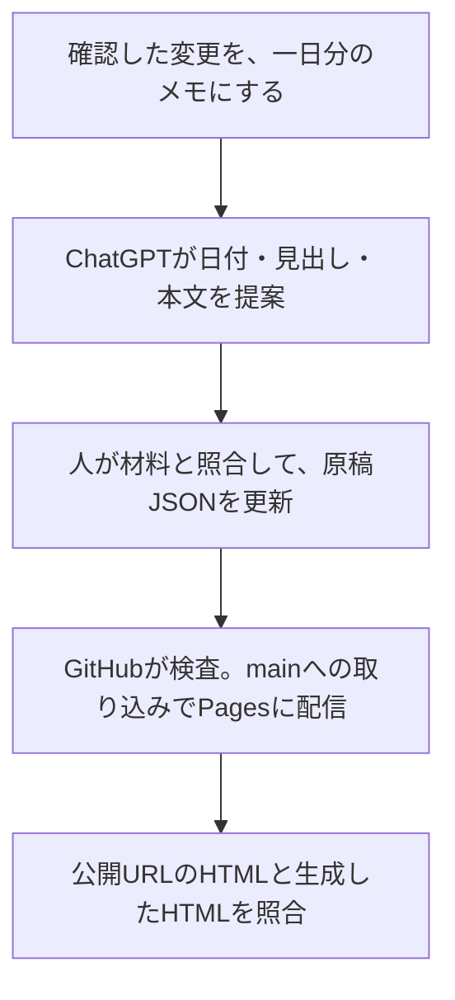
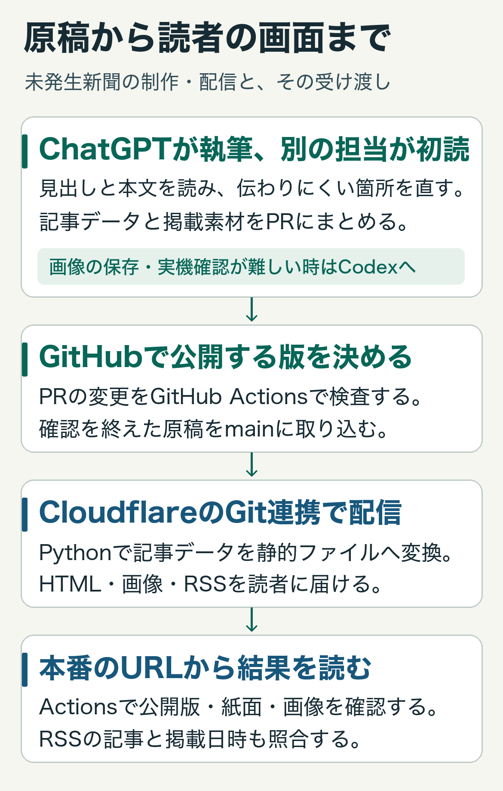
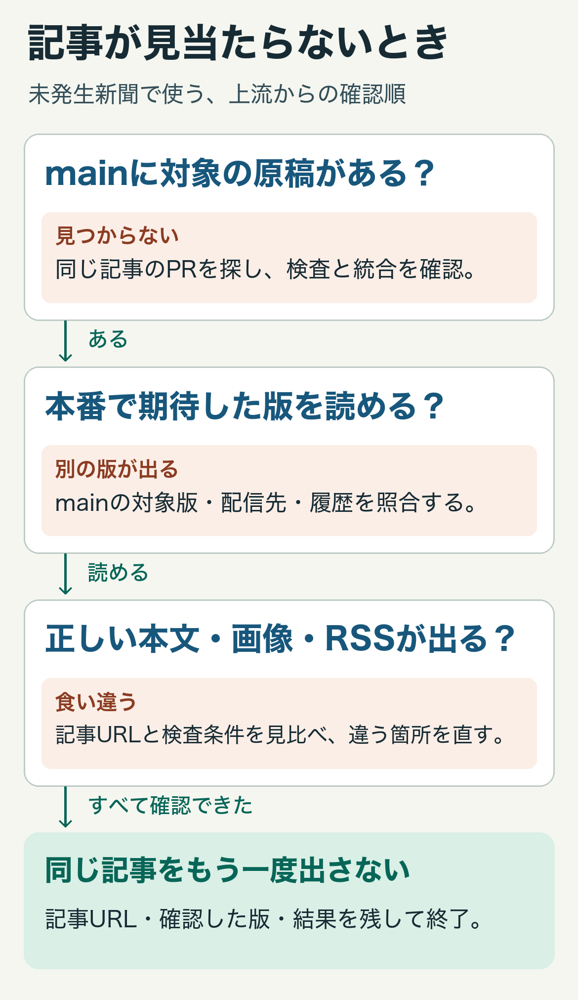

AIで個人サイトを作った。困るのは、その翌朝です。今日の原稿は何を見て書くのか。昨日と同じ話を出していないか。AIが「更新しました」と言ったとき、読者の画面も本当に変わったのか。

個人で運営する「未発生新聞」は、現実の話題から5年後の珍事を描く創作新聞です。2026年11月9日から15日の7日間に49本の記事を載せました。その仕組みのうち、個人サイトでも小さく真似できるのは、**AIに事実から原稿案を作らせ、承認した一つのファイルからページを自動生成し、最後に読者が開くURLを調べる**部分です。本文は先に作って静的ファイルで配るので、閲覧のたびに生成AIを呼ぶ必要がありません。[実際の新聞](https://veripsa.com/)

まず、この流れで**自分の更新日誌を一度書き換える**小さな実習をします。次に、本物の新聞で「空のはずの盤面に駒が写った写真」と「公開に成功したのに赤い検査」をどう扱ったかをたどります。教材をダウンロードすれば、ローカルで動かすのに必要なのはPython 3.12だけ。公開まで試す場合は、自分のGitHubアカウントと公開リポジトリを使います。

**目次**

1. [一枚の更新日誌を作る](#一枚の更新日誌を作る) — 教材を動かし、AIの一文で画面が変わるのを確かめる
2. [毎朝の仕事を一つ渡す](#毎朝の仕事を一つ渡す) — 材料、指示文、更新しない日の扱い
3. [承認したら自動で配信する](#承認したら自動で配信する) — 自分のGitHub Pagesで公開版を照合する
4. [新聞の本番をたどる](#新聞の本番をたどる) — ChatGPTからCloudflareまで、スポーツ面の実例
5. [費用が増える場所を選ぶ](#費用が増える場所を選ぶ) — 静的配信、動的機能、AIを使う頻度
6. [更新が見えないとき](#更新が見えないとき) — 二重投稿する前に上流から調べる
7. [一日分の実測を読む](#一日分の実測を読む) — 16の予定、44スレッド、7本の原稿の内訳

## 一枚の更新日誌を作る

たとえば、自分のツールの更新日誌。「検索欄の下に入力例を一つ追加した」なら、その一文が今日の材料になります。ここで作るのは、読者が開くページが一枚のサイトです。新聞本番のCloudflareをそっくり移す必要はありません。



教材は3ファイルです。`entries.json` が原稿、`build.py` が静的ページを作るプログラム、`pages.yml.example` があとで使う公開手順です。公開前に手元で動かせます。[教材の固定版](https://github.com/RollNuts/zenn-content/tree/f6888d4cd15f3b76e77b6c549bf6d087b8e8cb9b/examples/daily-static-desk)

macOSやLinuxのターミナルなら、空の作業フォルダーで次を実行します。Windowsでも、上のリンクから同じ3ファイルを一つのフォルダーに保存すれば、Pythonの手順から試せます。Windowsで `python3` が見つからない場合は、Python 3.12を入れたうえで `py -3.12` に読み替えてください。

```bash
mkdir daily-static-desk
cd daily-static-desk
base=https://raw.githubusercontent.com/RollNuts/zenn-content/f6888d4cd15f3b76e77b6c549bf6d087b8e8cb9b/examples/daily-static-desk
curl -fLsSLO "$base/entries.json" &&
curl -fLsSLO "$base/build.py" &&
curl -fLsSLO "$base/pages.yml.example" &&
python3 build.py &&
python3 -m http.server 8000 --bind 127.0.0.1 --directory dist
```

`http://127.0.0.1:8000/` を開きます。「小さな更新日誌を始めました」が一件、末尾に「原稿版 `e3eab5ffdcb9`」が表示されたら初回は成功です。そのターミナルは開いたままにしてください。

**二回目で確かめたいのは、自分の変更が届くこと。** 通常のChatGPTに「11月17日の確認済み変更は、検索欄の下に入力例を一つ追加したこと。効果は未測定」と渡したところ、次の一件が返りました。実習用の架空の更新です。

```json
{"date":"2026-11-17","title":"検索欄に入力例を追加","body":"検索欄の下に入力例を一つ追加しました。効果は未測定です。"}
```

`entries.json` の末尾の `]` の手前で、既存の `}` の後ろにコンマを一つ置き、このオブジェクトを加えます。同じフォルダーで別のターミナルを開いて `python3 build.py` をもう一度実行し、ブラウザを再読み込みしてください。11月17日の見出しが先頭に増え、原稿版の12桁も変わります。この12桁は原稿ファイルの内容から計算するので、同じ入力でもう一度ビルドすると同じ値になります。空白や改行だけでも値は変わるので、二回目は自分の端末に出た値と画面を比べてください。

では、定期担当が同じ日を二度扱ったらどうなるか。試験用のコピーで11月17日の行をもう一件追加すると、ビルドは「同じ日付が2件あります: 2026-11-17」で止まり、直前まで読めたHTMLはそのままです。日誌の単位を「一日一件」と決めたからできる検査です。実際に日に何本も発行する新聞では、担当枠や記事を識別するslugを使います。

## 毎朝の仕事を一つ渡す

AIが必要なのは、変更メモを読者に伝わる文章にするところです。タスクに「毎朝、お知らせを考えて」とだけ頼むと、伝えるべき変更が一つもない日も、それらしい文章を作れてしまいます。次の例では**材料を置く場所と、何も出さずに終える条件**を決めます。

> 毎朝9時（日本時間）に、指定した更新メモを確認してください。見るのは今日の日付がついた「公開可」の項目だけです。事実を追加せず、読者に何が変わったかを短く書いてください。返すのは `date`・`title`・`body` のJSON一件。日誌に同じ日付があれば既存原稿を示し、追加しません。メモに「変更なし」と明記されていたら `SKIP`、当日欄が空、公開可の材料が不明、またはメモや日誌を読めなければ `要確認` と理由を返してください。結果はこのチャットに残し、公開は担当者が判断します。

「指定した更新メモ」には、自分の公開リポジトリに置いたメモなど、**そのタスクから読める実際の場所**を入れ、照合先の `entries.json` のURLも渡します。まず通常のチャットで一回試すのがおすすめです。今回の二日分の試行では、変更のある日は上のJSONを、翌日の「公開できる変更なし」には `SKIP` を返しました。これはプロンプトの手動試験です。

定期化するときは、ChatGPTでこの指示と繰り返す時刻を指定し、スケジュール一覧で有効状態と初回の**実行結果**を確認します。Webのタスクから手元のフォルダーは直接読めません。接続済みの情報源を読む設定にするか、最初はメモを渡すところだけ自分で行えます。定期機能の利用可否は契約・ワークスペースによります。[OpenAI公式の定期タスク案内](https://learn.chatgpt.com/docs/automations)

確認する人は、返ってきた原稿と材料を左右に置きます。「入力例を追加した」は差分で確認できる。「検索が便利になった」「問い合わせが減った」は測っていない。この一件で採用するのは前者だけです。読めなかった日の「要確認」を「変更なし」に変えてしまうと、翌日も誰も調べなくなります。

## 承認したら自動で配信する

ここからは自分のサイトを持ちたい人向けです。教材はGitHub Pagesを使います。まず見本の一件を公開し、次に先ほどの二件目を更新として出すと、どこが自動になったかを目で確認できます。独自ドメインを買わず、標準の `github.io` アドレスを使えます。GitHub Freeでは公開リポジトリでPagesを利用できます。[GitHub Pagesの利用条件](https://docs.github.com/en/pages/getting-started-with-github-pages/what-is-github-pages)

1. 自分のGitHubアカウントに `daily-static-desk` という**公開リポジトリ**を作り、既定ブランチを `main` にします。ルートに、教材の固定版の `build.py` と**一件だけの元の** `entries.json` を置きます。ローカルで作った `dist/` は不要です。
2. リポジトリの **Settings → Pages → Build and deployment → Source** で **GitHub Actions** を選びます。次に、`pages.yml.example` の内容を **`.github/workflows/pages.yml`** として保存し、mainに反映します。このファイル名と置き場所でワークフローが有効になります。[GitHub公式のPages設定](https://docs.github.com/en/pages/getting-started-with-github-pages/configuring-a-publishing-source-for-your-github-pages-site)
3. **Actions → Build and publish the journal** を開きます。初回の `publish` が成功したら、環境 `github-pages` のリンクを開き、見本一件と原稿版を確かめます。URLは通常 `https://アカウント名.github.io/daily-static-desk/` です。
4. 二件にした `entries.json` を作業ブランチで保存し、PRを作ります。差分がこの原稿だけか、本文が変更メモに合っているかを読みます。PRの `build` は必須欄の欠落や同じ日付の二重登録を検出します。更新を見送った日の空きは許容します。mainに取り込むと、同じ実行で生成したHTMLがPagesに配られます。公開URLを開き直して**新しい見出しと自分の二回目の原稿版**を探してください。

公開処理には、受け付けられたときと、読めるようになったときのずれがあります。教材の最後のステップは公開URLからHTMLを取得し、ビルドしたHTMLとSHA-256が一致したかを確認します。旧版なら回数を限って待ち、一致しなければ失敗で終わります。ページ末尾の12桁は人が見る**原稿**の目印、ここで比較するのは**HTML全体**です。[配信と確認のワークフロー](https://github.com/RollNuts/zenn-content/blob/f6888d4cd15f3b76e77b6c549bf6d087b8e8cb9b/examples/daily-static-desk/pages.yml.example)

この教材では、AIの提案をPRに写して採用するところを人が一度引き受けます。日程の実行、文章の採否、サイトの配信は、それぞれ一つずつ自動化の範囲を広げられます。今回こちらで再現したのは、通常GPTの応答、ローカルでの二回のビルド、HTTPでの新旧HTMLの判定までです。教材用の公開サイトや読者のアカウントに定期タスクを作って試したものではありません。

## 新聞の本番をたどる



ニュース本文の正本は `content/articles.json` です。原稿が変わると、Pythonが記事ページ、一面、RSSなどを `dist/` に生成します。PRではGitHub Actionsが記事データとコードを検査し、Workerは本番に送らずパッケージできるところまで試します。

mainに原稿が入ると**二つの仕事が並行して**始まります。一つはCloudflareのGit連携が新しい版をビルドして配信する仕事。もう一つはGitHub Actionsが、期待した版が本番に現れるのを待ち、記事や共有画像を確かめる仕事です。リポジトリをコピーしただけではCloudflare側のGit連携は設定されません。読者向けのPages教材では、この二つをひとつのワークフローで順に行います。[新聞の構成とビルド条件](https://github.com/RollNuts/mihassei-news/blob/8e0f30b2da698c46f5ba15f1d082cb3ec0481f11/docs/ARCHITECTURE.md)・[PRの検査](https://github.com/RollNuts/mihassei-news/blob/8e0f30b2da698c46f5ba15f1d082cb3ec0481f11/.github/workflows/check.yml)・[本番を読む処理](https://github.com/RollNuts/mihassei-news/blob/8e0f30b2da698c46f5ba15f1d082cb3ec0481f11/.github/workflows/verify-public-photos.yml)

**11月16日のスポーツ面では、盤上に駒が一つでもあったら、その写真は使えませんでした。** 「一枚も置かずに優勝した選手」を描く架空の記事だったからです。実際の版を追うと、何を自動化しても最後まで残る判断が見えてきます。[完成したスポーツ面](https://veripsa.com/articles/unsolvable-ai-puzzle-cup-zero-pieces-wins/)

**題材を拾う。** 起点は、日本パズル協会が案内した実在の早解き大会です。ここから「速く解く人に点が入る」を「解けないと証明した人にも点が入る」にひっくり返す。協会の案内は出典に、架空の大会名、選手、勝敗は創作に属します。原稿データにはその境目も残ります。[大会の案内](https://www.jpuzzle.jp/2026/09/tokyo-puzzle-day-2026/)・[記事データの固定版](https://github.com/RollNuts/mihassei-news/blob/8e0f30b2da698c46f5ba15f1d082cb3ec0481f11/content/articles.json)

**別の読み手に渡す。** 初稿には「AIが別々の課題を作り」とありました。一試合ごとに問題が変わるのか、同じ試合の二人が違う問題を解くのか。後者だと勝負の公平さが気になり、肝心のパズルに集中できません。初めて読む担当の指摘を受けて、「試合ごとにAIが新しい課題を作り」と直しました。初読担当に渡すのは見出し、要約、本文。執筆中の相談や「ここを面白がってほしい」という答えを渡さないのが工夫です。[発行時の修正記録](https://github.com/RollNuts/mihassei-news/pull/782)・[編集手順](https://github.com/RollNuts/mihassei-news/blob/8e0f30b2da698c46f5ba15f1d082cb3ec0481f11/docs/EDITORIAL_LOOP.md)

**出したものを確かめる。** この一本の時計を並べると、予定から掲載確認までに何が起きたかが見えます。すべて日本時間です。

| 11月16日の時刻 | 残っている記録 |
| --- | --- |
| 09:30 | 発行予定枠。ChatGPTの発行担当には、この枠でスポーツ面を扱った履歴がある |
| 09:58:57 | 記事データに記録した掲載日時。RSSにもこの時刻が載る |
| 10:07:54 | 原稿を載せたPRがmainに取り込まれた |
| 10:12:26 | この版の本番配信検査が成功して終了した |

RSSの時計では09:58でも、その時刻にはまだPRが統合されていません。最初の読者が何時何秒に読めたのかまでは分かりません。さらに、記事に登場する選手が優勝したのは物語の中の**2031年11月16日**。これをRSSに入れると、5年先の記事を今日配ってしまいます。[発行PR](https://github.com/RollNuts/mihassei-news/pull/782)・[本番検査](https://github.com/RollNuts/mihassei-news/actions/runs/43784420246)・[新聞のRSS](https://veripsa.com/feed.xml)

**公開後、写真を見送って図を載せる。** 5×5の市松模様に、黒が13マス、白が12マス。白を一つ残す指定なので、埋めるのは黒13・白11です。隣り合う2マスを覆う部品は、どこに置いても黒と白を一つずつ使います。12枚なら黒12・白12。どう置いても合いません。空の盤面で勝てる理由を伝えるには、選手の表情より、二組の数を見比べられるほうがいい。後から回収できた写真は、駒が写っていたので不採用。12:13に取り込まれた別のPRで、比較できる図を追加しました。本文にはSVG、リンクを共有したときにはPNGが出ます。[図を追加した変更](https://github.com/RollNuts/mihassei-news/pull/787)・[画像の採否を記した編集メモ](https://github.com/RollNuts/mihassei-news/blob/8e0f30b2da698c46f5ba15f1d082cb3ec0481f11/docs/DAILY_EDITORIAL_BRIEF.md#L39)


## 費用が増える場所を選ぶ

費用を左右するのは「AIを使うか」だけではなく、**一記事ごとに一度動かす処理と、一回の閲覧ごとに動かす処理をどこで分けるか**です。未発生新聞は、同じ本文が百回読まれても、そのたびにAIを呼んだりHTMLを生成したりしません。一方、コメント・投票・計測などのAPIを使った閲覧では、背後で動的処理が走ります。[静的アセットとAPIの配信設定](https://github.com/RollNuts/mihassei-news/blob/8e0f30b2da698c46f5ba15f1d082cb3ec0481f11/wrangler.jsonc)

| 工程 | この構成でいえること |
| --- | --- |
| 手元で紙面を作って読む | 基本ビルドにはPython標準ライブラリを使う。生成APIのキーもCloudflareのアカウントも不要 |
| 変更を自動検査する | 公開リポジトリのGitHub標準ホステッドランナーは計算時間が無料。保存容量などは別条件。[GitHubの料金説明](https://docs.github.com/en/billing/concepts/product-billing/github-actions) |
| 読者へ届ける | Cloudflareでは静的アセットに直接届くリクエストは無料。Workerを通る動的処理やデータ保存には別の枠がある。[Cloudflareの料金説明](https://developers.cloudflare.com/workers/platform/pricing/) |
| AIと端末を使う | 運用方針は、既存の利用枠と端末を使い、追加の有料API・GPU・クレジットを購入しないこと。契約料、独自ドメイン、電気代を含む月の総額は今回集計していない |

もう一つ、新聞では本番以外のCloudflareプレビュービルドを止めています。ブランチごとのプレビューがデータ保存に使うDurable Objectsの無料枠を消費したためです。PRではテストとパッケージ検査を続け、本番への反映は統合後に一度確かめます。自分のサイトなら、まず画像、コメント、投票を付けずに始め、必要になった機能だけ、何回呼ばれいくらかかるかを確認して足せます。[判断を残した構成資料](https://github.com/RollNuts/mihassei-news/blob/8e0f30b2da698c46f5ba15f1d082cb3ec0481f11/docs/ARCHITECTURE.md#L73-L81)

追加料金を前提にしないと、足りないときの選択肢が変わります。写真の利用枠や実機が足りなければ、「今ある図だけで読者が理解できるか」を先に判断できる。冒頭のパズル面では、それでむしろ数字の合わない理由がよく見える紙面になりました。

自分のサイトで最初の一週間に控えておくとよいのは、公開できた本数、原稿や画像を生成し直した回数、公開前後の請求画面の差額です。追加料金が生じた週なら、その差額を公開本数で割ると、次の一件にどこまで手間をかけるか考えやすくなります。定額契約を含めて比べたい場合は、加えた費用の範囲も同じメモに残します。

人が担うのは、どんな新聞を出すのか、どこまでを自動で出してよいのか、どの契約や端末を使うのかを決めることです。個別の記事を一人ずつ人が検品したという記録はありません。「全工程を放っておける」という効果も、この一日の数字からは読み取れません。

## 更新が見えないとき



読者の画面が古いとき、上流から一つずつ見ます。mainに原稿がなければ既存PR、あれば配信側の版、それも合えば公開ページの中身です。新聞では [/build-revision.txt](https://veripsa.com/build-revision.txt) を読みます。運用文書だけを変えたコミットは配信対象外なので、公開中の版が祖先で差分が `docs/` だけだと確かめられる場合に限り、古い版でも同じ公開物と認めます。教材では代わりにページ末尾の原稿版とHTML全体の照合結果を使います。[新聞の版確認](https://github.com/RollNuts/mihassei-news/blob/8e0f30b2da698c46f5ba15f1d082cb3ec0481f11/scripts/check_live.py)

11月15日、36件のコミットで紙面を検証する `Validate newspaper` は36件とも成功しました。一方、公開されたサイトを見に行く検査は、同じ36件で**成功30、失敗4、取消2**。同じ「緑か赤か」でも、見ていた場所が違います。

午後の失敗ログを一つ開くと、読者に届いている版は、すでに公開したかったコミットと一致しています。それでも検査は最後の15回目まで赤でした。一面のCSSを一本だけと想定していたところへ、写真読み物用のCSSがもう一本加わっていたためです。

この状況でAIに「公開に失敗したのでやり直して」とだけ渡すと、正しい記事をもう一度出す理由ができてしまう。実際に取り込まれた修正は、本番を検査するPythonスクリプト一つでした。公開中の版を確かめたうえで、追加のCSSも個別に照合するように直しています。検査の失敗4件をそのまま「サイトが4回落ちた」とは数えられない理由でもあります。[実際の失敗ログ](https://github.com/RollNuts/mihassei-news/actions/runs/43679438381/job/132706632236)・[検査を直したPR](https://github.com/RollNuts/mihassei-news/pull/762)

ここは小さなサイトにも持ち帰れます。「公開失敗」を引き継ぐとき、**対象のURL、出したかった版、実際に読めた版、食い違った箇所**まで書く。その四つがあれば、次の担当は原稿を書くところまで戻る必要がありません。

## 一日分の実測を読む

11月15日（日）の0時から翌0時までを切り出しました。この日、新しく紙面に加わったニュースは**7本**。同じ24時間を編集側から見ると、次の数字になります。

| どこを数えたか | 11月15日の実測 | その数字で分かること |
| --- | ---: | --- |
| Codexで作業が始まったスレッド | **44** | この端末の新聞プロジェクトに限定。親の作業チャット3、子スレッド40、内部レビュー1 |
| そこで始まった作業ターン | **189回** | 同じチャットを再利用した回も含む。親35、子150、内部レビュー4 |
| 同時に作業区間が重なったスレッド | **最大10** | ツール実行や待機を含む。モデルの同時推論数は測っていない |
| GitHub Actions | **176回** | mainへのpushで始まった実行。対象は36のコミット。定時実行やPR上だけの検査は集計外 |
| 読者側のWebセッション | **28訪問・136ページ表示** | サイト側が30分の無操作で区切った訪問。実人数や、運営側の確認を除いた純読者数は不明 |

たとえばCodexの親チャットで始まった35回を、開始理由で分けると、定期起動6回、すでに動いていた目標の続き18回、端末からの操作を起点にしたもの11回です。毎回ゼロから新聞を作ったわけではありません。Codexの運用総括を1日9枠とするのは16日に確認した設定、6回は15日にこの端末で観測した起動です。差の3回が失敗だったと判断できる記録はありません。

後述するChatGPTの16件は**翌日に有効だった担当タスクの数**です。一つの担当が日に何度も動くため、タスクの件数から前日の実行回数は求められません。通常GPT全体で同時にいくつの会話が動いたか、他の端末で何回作業したかは、この集計の外です。「これで毎日何時間浮いたか」も計っていません。

:::details 集計の範囲と追試の手がかり
- **記事数**は記事JSONの `published_at` を日本時間で集計。11月15日のmainの始点と終点でも107件から114件へ増え、追加7件、削除0件でした。[当日分の比較](https://github.com/RollNuts/mihassei-news/compare/0cedbfac12957e72a1a51a27218376021b59c300...0ec119c27acb6e232da7d82d9a26d3a93bd2ad74)
- **Codex**はこの端末で、新聞の作業場所に紐づく開始・終了の記録だけを集計しました。分岐で引き継いだ過去の記録を取り除き、同じターンを一度だけ数え、所有するスレッドをまとめました。ピークの計算では、前日からの持ち越し2回を加えた191区間を当日の範囲に切り、秒単位で重なりを数えています。元の会話は非公開なので、ここは運営者の集計値です。
- **GitHub**は同日の日本時間に作成された `main`・`push` のrun IDを一意に集計。176回の内訳は成功170、失敗4、取消2でした。[GitHub Actions履歴](https://github.com/RollNuts/mihassei-news/actions)
- **読者側**はPV・セッションともに日次集計の対象期間が一日を覆うことを確認しました。[公開している日次集計](https://github.com/RollNuts/mihassei-news/blob/8e0f30b2da698c46f5ba15f1d082cb3ec0481f11/analytics/daily/2026-11-15.json)
:::

11月16日にChatGPTの「アクティブ」一覧を読み、新聞の運用表と写真特集の名簿に照らすと、**新聞に対応づけられたスケジュールは16件**ありました。内訳は下表の9件と、写真素材を制作する7件です。これは登録されている仕事の数です。発行担当一つが日に何度も起動する一方、週次の担当が休んでいる日もあります。

:::details 16件の担当と時刻を見る
| ChatGPTの担当 | いつ動く設計か（JST） | 次に渡すもの |
| --- | --- | --- |
| 題材探し・品質改善 | 毎朝05:45 | 前日の記事を読み返し、伝わりにくかった点と次の候補を編集メモへ |
| ニュース発行 | 07:30〜23:30、2時間ごと | 原稿、記事用画像、発行記録。通常は最初の7枠、最後の2枠は回収や強い企画に使う |
| 公開後レビュー・画像回収 | 07:55〜翌00:55の毎時、計18枠 | 新着・改稿・初読待ちを点検し、必要なら同じPRで修正する |
| 週次編集・成長判断 | 月曜04:30 | 先週の結果を踏まえ、次週に変えることを一つ決める |
| サイト日次改善 | 水曜を除く毎日02:15 | 表示・操作の不具合や、担当が決まっている未完了作業の修復 |
| 週次SEO・UX改善 | 水曜02:15 | その日の日次改善に代わり、検索導線や主要ページを横断して確認 |
| 写真特集の編集・公開 | 毎日03:30 | 当日の一人分の素材とコラムを週刊号に追加する |
| 未来相場観測室 | 平日08:30・09:40・12:40・15:50 | 観測した時刻と予測の条件を残し、後から同じ記録に結果を追記する |
| 記事紹介の配信監視 | 毎日11:40・17:40・22:40 | 配信漏れや文面の異常を点検。実際の送信は別の処理が担う |

写真特集では、**架空のモデル7人に一つずつ素材制作の予定**があります。素材を受け取る編集担当は、日曜から土曜の担当を割り当て、一人につき写真10枚とコラムを掲載します。編集担当まで画像を生成し始めると、同じ特集の素材を二重に作ってしまい、どちらを採用したか分からなくなる。制作と掲載の仕事を切った理由がここにあります。[公開の運用表](https://github.com/RollNuts/mihassei-news/blob/8e0f30b2da698c46f5ba15f1d082cb3ec0481f11/docs/OPERATIONS.md)・[特集の名簿と掲載データ](https://github.com/RollNuts/mihassei-news/blob/8e0f30b2da698c46f5ba15f1d082cb3ec0481f11/content/photo_issues.json)
:::

Codexには、08:10〜翌00:10の2時間ごと、1日9枠の運用総括・画像補完があります。写真を置く場所にファイルを保存できない、実機で表示を確かめる必要がある、といった引き継ぎが対象です。何も渡されていない回は作業を増やさず終了します。執筆・初読・誌面作成には普通のChatGPTが入っており、毎記事をCodexでもう一度作る工程はありません。

新聞の外側にも仕事があります。掲載済みの記事紹介は、GitHub Actionsが一日最大7枠を扱い、直近の実送信と重複を確認してBufferへ渡します。GPTの仕事はその監視です。朝の手動投稿用の文案、夜の振り返りも運用表にあります。原稿が用意できた段階、送信を頼んだ段階、公開先に現れた段階は、それぞれ別に確かめます。[記事紹介の運用](https://github.com/RollNuts/mihassei-news/blob/8e0f30b2da698c46f5ba15f1d082cb3ec0481f11/social-bot/README.md)

:::details 元の新聞でも掲載日と本数を追試する
Python 3.12とGitで、スポーツ面の盤面まで手元でたどれます。版を固定してあるので、明日新しい号が出ても同じ紙面です。

```bash
git clone https://github.com/RollNuts/mihassei-news.git
cd mihassei-news
git checkout --detach 8e0f30b2da698c46f5ba15f1d082cb3ec0481f11
python3 scripts/build.py
python3 -m http.server 8000 --bind 127.0.0.1 --directory dist
```

ブラウザで `http://127.0.0.1:8000/articles/unsolvable-ai-puzzle-cup-zero-pieces-wins/` を開くと図の載ったスポーツ面が出ます。同じサーバーの `/feed.xml` を開いて記事名を探すと、配信日は2026年です。この静的サーバーでは投票やコメントの保存はできません。

7日間の本数も同じ版から確かめられます。サーバーを起動したまま、別のターミナルでリポジトリのルートから実行してください。

```bash
python3 - <<'PY'
import json
from collections import Counter
from datetime import datetime, timedelta, timezone
from pathlib import Path

jst = timezone(timedelta(hours=9))
articles = json.loads(Path("content/articles.json").read_text())
days = Counter(datetime.fromisoformat(a["published_at"]).astimezone(jst).date().isoformat()
               for a in articles)
for day in sorted(d for d in days if "2026-11-09" <= d <= "2026-11-15"):
    print(day, days[day])
PY
```

11月9日から15日までの7行それぞれに `7` と出ます。ここまでに必要なのは公開データだけです。自分のサイトに最初から16件の予定を作る必要もありません。
:::

自分のサイトで最初に見たいのは、「AIが文章を返した」という通知よりも、**昨日と同じURLを開いたら、今日確認した一文だけが増えていた**という結果です。そこまで確かめられたら、次は毎朝の材料集め、画像の採否、公開後の見回りのうち、自分がいちばん時間を使っている仕事を一つだけ渡せます。

*通常のChatGPTを編集相談と実習用原稿の作成に、Codexを集計・教材作成・再現確認に使用しました。*
