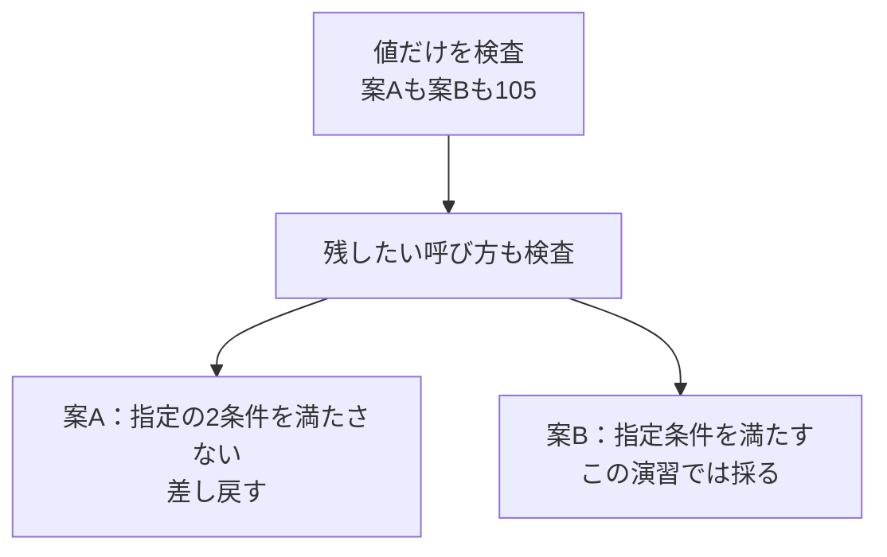

AIにエラーを渡し、修正を頼む。しばらくすると、差分と一緒に「直りました。テストも通っています」と返ってくる。

実行すると、確かに動く。でも、変更されたコードを全部説明できるほど詳しくはない。このまま採ってよいのか、もう一度AIに聞くべきなのか。そこで手が止まる人へ向けた記事です。

まず、**「何ができれば採るか」を書き、その条件を実際に確認した結果があるかを見る**ところから始めます。今回なら「合計が105になる」に加えて、「指定した呼び方を守る」ことまで必要です。同じ105を返す二つの修正でも、この条件を置くと採否が分かれます。

この記事では、Pythonの小さな関数でその違いを自分で確かめ、最後に自分の修正へ持ち込めるレビュー用メモを作ります。変更の目的、呼び出し方、確認結果をつないで読みます。

**先に結論と使うメモを見たいなら**、次の「同じ105でも採否が分かれる」の表から、「採用判断を一枚に残す」へ進んでください。実行する時間が取れたら、Python 3.12とファイル一つで二案を試せます。

この順に進めます。

1. [同じ105でも採否が分かれる](#同じ105でも採否が分かれる) — 二案と答えを先に見る
2. [ファイル一つで確かめる](#ファイル一つで確かめる) — 取得、4コマンド、期待結果
3. [残したい使い方を言葉にする](#残したい使い方を言葉にする) — 要求とテストを結ぶ
4. [六つの呼び出しを予想する](#六つの呼び出しを予想する) — 手を動かして違いを読む
5. [手元の修正をどこから読むか](#手元の修正をどこから読むか) — 差分とAIへの依頼
6. [採用判断を一枚に残す](#採用判断を一枚に残す) — 採用、差し戻し、保留を選ぶ

## 同じ105でも採否が分かれる

:::message
以下の関数・要求・修正案は架空の教材です。実際にAIが提案した修正や、実サービスで起きた障害の再現ではありません。AIへの依頼の考え方と、教材で実測した結果を分けて扱います。
:::

金額と手数料を足す関数を考えます。`fee`をキーワード専用にしたところ、古い呼び出し方が残っていました。

```python
def total(amount, *, fee=5):
    return amount + fee

def checkout():
    return total(100, 5)  # TypeError
```

`total(100, 5)`は、順番で「100と5」を渡しています。これを位置引数と呼びます。一方、`total(100, fee=5)`は、手数料の値に`fee`という名前を付けて渡します。

関数定義の`*`より後ろにある引数はキーワード専用です。したがって、この関数へ手数料を指定するときは`fee=5`と書く必要があります。上の古い呼び出しは、その約束に合わないため失敗します。[Python公式のキーワード専用引数の説明](https://docs.python.org/ja/3.12/tutorial/controlflow.html#keyword-only-arguments)

エラーを消す修正を二つ並べます。

**案A：関数から`*`を外し、古い呼び出し方を受け付ける。**

```python
def total_rollback(amount, fee=5):
    return amount + fee

def checkout_rollback():
    return total_rollback(100, 5)
```

**案B：`*`を残し、呼び出す側に`fee=`を付ける。**

```python
def total_keyword(amount, *, fee=5):
    return amount + fee

def checkout_keyword():
    return total_keyword(100, fee=5)
```

案Aでも案Bでも、対応する`checkout`は105を返します。「100に5を足せたか」という検査なら、どちらも合格です。どちらを採るか、その理由を一度考えてみてください。

ここで、この演習の要求を三つに固定します。

1. `checkout()`は105を返す。
2. `fee`は定義上、キーワード専用にする。
3. 位置引数による`fee`の指定は拒否する。

この要求で比較した結果が、次の表です。

| 確認すること | 案A：関数を戻す | 案B：呼び出しを直す |
| --- | --- | --- |
| `checkout()`が105を返す | 満たす | 満たす |
| `fee`がキーワード専用 | 満たさない | 満たす |
| 位置引数の`fee`を拒否する | 満たさない | 満たす |
| この三条件での採否 | 差し戻す | 採る |

**今回の要求なら、採るのは案Bです。** 案Aはエラーを解消すると同時に、守ると決めた呼び出し方の制約まで取り除いています。

ただし、要求が「古い位置引数の呼び出しを引き続き動かす」なら、判断は変わります。`*`を残すこと自体を正解として覚える必要はありません。何を維持し、何を変えるかが採否を決めます。

## ファイル一つで確かめる

自分の環境でも試します。必要なのはPython 3.12と、公開しているファイル一つです。

まずターミナルで、使用するPythonの版を確認してください。

```sh
python3.12 --version
```

以下では、このコマンドでPython 3.12を起動できる環境を前提にします。`command not found`などになる場合は、まだ教材を検査できていません。Pythonの導入方法や起動コマンドはOS・環境で異なります。別の起動コマンドを使う場合も、そのコマンドの`--version`で3.12であることを確かめてから読み替えてください。

次に、[再現コードの全文](https://github.com/RollNuts/zenn-content/blob/a127a99bc240e13f981dbccaa1a1dd1fa7b4a552/examples/api-contract-repair/repair_review.py)を開き、GitHubの「Raw」からコード本文を表示して、`repair_review.py`という名前で保存します。[コード本文への直接リンク](https://raw.githubusercontent.com/RollNuts/zenn-content/a127a99bc240e13f981dbccaa1a1dd1fa7b4a552/examples/api-contract-repair/repair_review.py)も使えます。再現コードはコミットへ固定しています。

保存したディレクトリでターミナルを開くか、そこへ移動してください。ファイル名の末尾に`.txt`が付いていないことも確認します。実行には、このファイル全体を使います。

取得後の実行には、Git、AIモデル、アカウント、ネットワーク接続、追加パッケージは使いません。

### まずは戻り値だけを検査する

次の2行を、それぞれ実行します。

```sh
python3.12 repair_review.py --repair rollback --value-only
python3.12 repair_review.py --repair keyword --value-only
```

`rollback`は案A、`keyword`は案Bです。`--value-only`を付けると、`checkout()`が105を返すかだけを検査します。どちらも1テストが成功し、末尾は`OK`、終了コードは0になります。

ここで確認できた事実は、二案ともこの入力で105を返したことです。まだ、位置引数を拒否したかは調べていません。

### 呼び出し方も含めて検査する

次は`--value-only`を外します。**案Aの実行は失敗するのが期待結果**です。そこで止めず、案Bのコマンドまで1行ずつ実行してください。

```sh
python3.12 repair_review.py --repair rollback
python3.12 repair_review.py --repair keyword
```

4コマンドを`&&`で連結すると、案Aの失敗で後続が実行されないため、ここでは独立して試します。

Python 3.12.13で、同じファイルを実際に実行して確認した結果です。

| 修正案 | 戻り値だけ | 全検査 | 全検査の終了コード |
| --- | --- | --- | ---: |
| 案A：`rollback` | 1件成功 | 4件中2件失敗 | 1 |
| 案B：`keyword` | 1件成功 | 4件成功 | 0 |

案Aで失敗するのは、次の2件です。

```text
test_fee_is_keyword_only ... FAIL
test_positional_fee_is_rejected ... FAIL
```

これはテスト名と状態を抜き出した表示です。実際の出力にはクラス名、失敗内容、実行時間なども付きます。案Aの末尾は`FAILED (failures=2)`、案Bの末尾は`OK`になります。

この赤い結果は、案Aが今回の採用条件を満たさないことを検出しています。ファイルが見つからない、`SyntaxError`になる、そもそも4件が実行されない、という結果とは区別してください。「失敗したから教材どおり」ではなく、**どの検査が、なぜ失敗したかまで合わせます。**

リポジトリを取得済みなら、ルートから`python3.12 scripts/verify_api_contract_example.py`で4実行をまとめて照合できます。案Aの指定2件だけが失敗することも含め、テスト名・件数・結果・終了コードを確認し、期待どおりなら検証器は成功します。今回の追試も、このローカル検証を使っています。

## 残したい使い方を言葉にする

「直して」という依頼には、今のエラーを消すことと、変更で実現したかった使い方へそろえることの両方が入りえます。案Aは前者を満たしますが、後者に置いた条件を満たしません。

自分の作業へ置き換えるときは、「今は何が起きているか」と「どの状態なら採るか」を分けて書くと、依頼が具体的になります。

```text
今起きていること：checkout()を実行するとTypeErrorになる
変更の目的：手数料はfeeという名前を付けて指定する形へそろえる
採る条件：105を返し、キーワード指定を許し、位置引数のfeeを拒否する
```

1行目の症状だけでは、案Aと案Bを分ける材料がありません。残りの行で、修正後に守る約束を渡します。

ここでいう**API契約**は、Python関数の引数と呼び出し方についての約束です。HTTP APIの仕様を指しているわけではありません。今回なら、何を渡してよく、何を渡したら止めるかを記録します。

### 許可する例と拒否する例は別に書く

`total(100, fee=5)`を許可することと、`total(100, 5)`を拒否することは、別の条件です。案Aは前者を満たしていても後者を満たしません。

「正しい入力で動くなら、間違った入力は当然止まるはず」と考えると、この違いが抜けます。許可する一例が成功しただけでは、許可していない呼び方がどう扱われるかは分かりません。

逆に、拒否する例だけを検査しても、使ってよい呼び方まで壊していないかが残ります。そのため、この教材ではキーワード呼び出しが105を返すことも確認します。

残したい条件まで調べると、二案の見え方が変わります。



見たいのは、テストの合計件数より、採否に必要な条件に確認手段があるかです。`--value-only`で成功しても、呼び方の条件まで確認したことにはなりません。

### 四つのテストは何を見ているか

以下は`unittest.TestCase`内の抜粋です。`total`と`checkout`には選んだ案の関数を割り当てています。実行には、先ほど保存したファイル全体を使ってください。

```python
def test_checkout_value(self):
    self.assertEqual(checkout(), 105)

def test_keyword_call(self):
    self.assertEqual(total(100, fee=5), 105)

def test_fee_is_keyword_only(self):
    parameter = inspect.signature(total).parameters["fee"]
    self.assertEqual(parameter.kind, inspect.Parameter.KEYWORD_ONLY)

def test_positional_fee_is_rejected(self):
    with self.assertRaises(TypeError):
        total(100, 5)
```

最初の二つは、実際に呼び出して戻り値を比較します。三つ目の`inspect.signature`は、引数の種類を調べます。`fee`が位置引数でも渡せるのか、キーワード専用なのかを、関数の定義から確認しています。[Python公式の引数の種類の説明](https://docs.python.org/ja/3.12/library/inspect.html#inspect.Parameter.kind)

四つ目の`assertRaises`は、指定した呼び出しが`TypeError`を発生させるかを調べます。例外が出なければ失敗です。定義の形を読む検査と、実際に呼んで拒否されるかを見る検査を分けています。[Python公式の例外の検査の説明](https://docs.python.org/ja/3.12/library/unittest.html#unittest.TestCase.assertRaises)

この四つを、どの修正にもそのまま当てはめるわけではありません。今回`inspect`を使うのは、「定義上キーワード専用であること」まで要求したからです。利用者に必要な振る舞いだけを決めている場面で、内部の形まで固定するテストを足すと、必要な変更まで制限することがあります。

また、`TypeError`が出たという事実だけでは、一般の関数内部で偶然起きた同じ例外と区別できません。今回の関数本体は数値の加算だけで、位置引数の指定が関数の定義と合わないことも確認できます。複雑な関数に持ち込むときは、許可した呼び方が動くかに加え、どこで、なぜ例外になったかも読みます。

## 六つの呼び出しを予想する

ここまで読んだら、既存の関数を使って、自分で呼び方を変えてみます。

`repair_review.py`を保存したディレクトリで、`python3.12`を起動します。画面に`>>>`が出たら、次の各行を1行ずつ入力してください。`>>>`自体は入力しません。

```python
from repair_review import total_rollback, total_keyword
total_rollback(100, fee=5)
total_keyword(100, fee=5)
total_rollback(100, 5)
total_keyword(100, 5)
total_keyword(100)
total_keyword(100, fee=0)
```

入力する前に、6回の呼び出しそれぞれについて、「数値が返るならいくつか」「例外になるか」を予想します。4回目は例外になりますが、対話環境は続くので、残りの2行も入力してください。終わるときは`exit()`を入力します。

:::details 答えと、結果から分かること
Python 3.12.13で既存の関数を直接呼んで確認した結果です。

| 呼び出し | 結果 |
| --- | --- |
| `total_rollback(100, fee=5)` | 105 |
| `total_keyword(100, fee=5)` | 105 |
| `total_rollback(100, 5)` | 105 |
| `total_keyword(100, 5)` | `TypeError` |
| `total_keyword(100)` | 105 |
| `total_keyword(100, fee=0)` | 100 |

最初の2行を見ると、キーワードを付けた呼び方は両案とも許可しています。次の2行で、位置引数を受け付けるかに差が出ます。

5行目の105は、`fee`を省略したため既定値の5が使われた結果です。キーワード専用は「毎回その引数を必ず書く」という意味ではありません。この関数には、渡さなかった場合の既定値があります。

6行目では、明示した0が使われて100になります。ただし、0を一度試しただけで、金額や手数料のあらゆる境界値を検証したことにはなりません。

例外のメッセージ全文や実行時間は、答え合わせの条件に含めません。今回見るのは、どの呼び方で数値が返り、どれが拒否されたかです。
:::

レビューのメモにも、数値に加えて、どの呼び方で確かめたかを残します。

### 要求だけを逆にしたらどうなるか

今度はコードを変えず、採用条件を次の二つに置き換えます。

1. 合計は105になる。
2. 既存の`total(100, 5)`という呼び出しを引き続き許可する。

この条件なら、AとBのどちらを採るでしょうか。

**この二条件だけで比べるならAです。** Bは、維持するよう求められた位置引数を拒否します。先ほど確認した実行結果は変わっていません。変わったのは、採否を決める要求です。

もし「位置引数は拒否する」という元の条件も残すなら、二つの要求が食い違います。この場合は、どちらかのテストを消して緑にする前に、互換性と移行方針を確認する必要があります。条件が決まるまで、判断は保留です。

## 手元の修正をどこから読むか

教材では関数も呼び出し側も小さく、違いは`*`と`fee=`に収まっています。自分のアプリでは、修正ファイルが増え、テスト結果も長くなるかもしれません。

そのときは、変更の目的から一つの利用場面を選び、関係する箇所をたどります。今回なら「手数料を指定して会計する」という場面です。

最初に読むのは、失敗した`checkout()`です。そこから呼び先の`total()`を見て、渡し方と受け取り方を対応付けます。最後に、両方の使い方をテストがどう確かめているかを読みます。この順番なら、差分の行数だけを見て「小さいから採る」と判断せずに済みます。

| 読む場所 | 自分に返す問い | この教材で見えること |
| --- | --- | --- |
| 要求の根拠 | 何のための変更だったか | `fee`をキーワード専用にする |
| 呼び出す側 | どの入力・呼び方が失敗したか | `total(100, 5)`が残っている |
| 呼ばれる側 | 何を受け付ける定義か | `*`の後ろがキーワード専用 |
| テストの中身 | 必要な条件のどこを確かめたか | 値だけなら二案とも成功 |
| 修正差分 | 目的に関係する約束を変えていないか | Aは制約を外し、Bは呼び方を合わせる |

実作業の「要求の根拠」には、合意済みの仕様、Issue、移行方針などを置きます。AIが後から書いた説明だけでは、その変更が望まれていたことの根拠にはなりません。

根拠が見当たらないときは、「古い呼び方を残すのか、新しい呼び方へ移すのか」のように、判断が分かれる点まで絞ります。漠然と「これで大丈夫ですか」と聞くより、決めるべきことが伝わります。

### テストも変更されていたら中身を読む

修正と一緒にテストが変わること自体は、問題ではありません。要求の変更に合わせて期待値を更新する場合もあります。

ただ、今回の要求を維持したまま`test_positional_fee_is_rejected`を削除すると、拒否する呼び方の確認がなくなります。さらに定義の検査も外せば、案Aでも残った検査は緑になります。その緑から言えることの範囲が変わっています。

テストの差分を読むときは、「この変更で、どの条件を確認しなくなったか」を一つ添えて見ます。削除の理由が要求の変更なら、その根拠まで記録します。理由が「落ちていたから」だけなら、先に採用条件へ戻ります。

### 同じ名前の結果でも対象が同じかを見る

「テスト成功」の結果を受け取ったら、どの版のコードを、どのコマンドで試したかも確認します。修正前の結果、別のディレクトリでの実行、対象を絞った検査では、今見ている差分への答えにならないことがあります。

今回なら、`--value-only`付きの成功と、全検査の成功を区別するだけでも差が分かります。実作業では、対象のcommitや作業状態、実行コマンド、実行したテスト名を残すと、後から結果と差分を対応付けられます。

### AIへ頼む内容を作業の前後で変える

AIに同じ「確認して」を繰り返すより、今必要な判断材料を指定します。ここでは、修正前、案を受け取ったとき、採用前の三つに分けます。以下は自分の作業に合わせて埋める依頼文です。この文面によるレビュー精度の改善や時間短縮は測っていません。

**修正前は、症状と残す条件を渡す。**

```text
起きていること：checkout()でTypeErrorになる
変更の目的：feeをキーワード専用にする
維持する使い方：total(100, fee=5)は105を返す
拒否する使い方：total(100, 5)
要求の根拠：今回の演習で指定した3条件

この条件を保つ修正案を示してください。
条件が食い違う場合は、判断が必要な点を先に示してください。
各案について、直る呼び出しと変わる呼び出しを説明してください。
```

実作業では「今回の演習」の部分を、確認できる要求へ置き換えます。分からない条件は「未確認」として渡します。

**案を受け取ったら、差分と条件を対応付けてもらう。**

```text
この修正案について、次の対応を示してください。
・各採用条件を確認するコードとテスト
・修正前後で許可／拒否が変わる呼び方
・変更したテストと、その変更が必要な理由
・まだ確認していない条件と、次に確認する方法

提案した検査と、実際に実行した検査を分けてください。
実行した場合は、対象の版、コマンド、結果を示してください。
```

返ってきた説明は、確認する場所への案内として使います。例えば「呼び出しの制約は維持した」と書かれていても、関数定義から`*`が消えていれば、説明と差分が合っていません。文章の説得力に加えて、案内された箇所を自分でも照合します。

**採用前は、残った判断だけを返す。**

```text
確認済み：値105、キーワード呼び出し、定義上のキーワード専用、位置引数拒否
未確認：ほかの呼び出し元、境界値、実サービスの移行要件
今回判断する範囲：教材で指定した3条件

確認済みの事実を根拠に、採用／差し戻し／保留と理由をまとめてください。
未確認の項目を確認済みとして補わないでください。
範囲外の判断が必要なら、必要な情報を具体的に挙げてください。
```

AIの結論に加えて、条件との対応表と、あとで再確認できる実行結果を手元に残します。

AIがテストを実行できない環境なら、未実行のコマンドを受け取り、自分の環境で実行した結果を照合します。「実行すると通るはず」と「この版で実行して通った」を、記録でも分けておきます。

## 採用判断を一枚に残す

レビューの最後には、見つけたことを次の作業へ渡せる形にします。結論は、採用、差し戻し、保留の三つから考えます。

| 判断 | この教材での例 | 次にすること |
| --- | --- | --- |
| 採用 | Bは三条件に対応する検査を満たした | 採る範囲と確認結果を残す |
| 差し戻し | Aはキーワード専用・位置引数拒否を満たさない | 満たさない条件を示して修正を求める |
| 保留 | 古い呼び方を残すか決まっていない | 互換性と移行の要求を確認する |

検査が未実行の場合も保留です。「要求が分からない」と「検証環境がない」では、次に必要な作業が違います。理由まで具体的に残します。

Bを採ると言えるのは、教材の条件についてです。実際のアプリでは、ほかの呼び出し元や利用者の移行も採用条件になるかを判断します。未確認の項目を列挙するだけで、採用の根拠になるわけではありません。

### 今回の結果を実際に埋める

次は、この教材の追試結果で埋めたメモです。これだけを渡された人にも、何を採り、何を確かめたかが分かるようにします。

```text
対象：repair_review.pyの二つの修正案
再現コードの版：a127a99bc240e13f981dbccaa1a1dd1fa7b4a552
目的：feeをキーワード専用にした状態でcheckout()を動かす
要求の根拠：教材で明示した3条件

確認すること：
  値：checkout() == 105
  許可：total(100, fee=5) == 105
  定義：feeがKEYWORD_ONLY
  拒否：total(100, 5)はTypeError

実行環境：Python 3.12.13
実行：repair_review.pyのrollback／keyword、各value-only／全検査
結果：値だけは両案1件成功。全検査はAが指定2件失敗、Bが4件成功
判断：この3条件ではBを採用。Aは定義と拒否条件を満たさず差し戻す
未確認：ほかの呼び出し元、境界値の網羅、実サービスの移行要件
次の作業：実アプリへ適用する場合は、その要求と呼び出し元を確認する
```

対象、要求、結果、判断をつなぐと、次の人も採用理由をたどれます。「安全」「問題なし」だけで済ませず、確かめた範囲を伝えます。

この例ではコードの固定版を載せています。手元に未コミットの変更がある場合は、commitだけでは現在の内容を表せないので、対象差分も一緒に渡してください。結果を取り直した後にさらにコードを変更したなら、その結果でどこまで言えるかも見直します。

### 自分の修正へ持ち帰る空欄

次の欄を、自分の作業について埋めてみてください。分からない箇所があれば、そこが追加で調べる候補です。

```text
対象の変更・版：
今起きていること：
変更の目的：
要求の根拠：

採るための条件と確認方法：
  期待する結果：
  許可する使い方：
  拒否する使い方：

実行した環境・コマンド：
結果：
未確認と、採否への影響：
判断と理由（採用／差し戻し／保留）：
次に確認すること：
```

全部の欄を長く埋める必要はありません。例えば拒否する使い方が今回の要求にないなら、その理由と対象外であることを記します。必要な判断が残っていないかを確かめるためのメモです。

記入例と空欄をまとめた[レビュー用メモ](https://github.com/RollNuts/zenn-content/blob/main/examples/api-contract-repair/review-note.md)も置いています。コピーして、Issueや修正依頼に添えられます。実際に他人へ渡すときは、公開できる要求と確認結果だけを記載してください。

## なぜこの小さな例を残したか

私がVeripsaを作り始めたのは、複数の開発作業でGitのコンフリクトが頻発し、それを改善したかったからです。

Gitのテキスト上の競合と、この記事の関数の呼び出し契約は、確認する対象が異なります。この教材はGitの競合を再現したものでも、Veripsaの検出能力を評価したものでもありません。

ここでは、「直した後に何を確認すればよいか」を、解析ツールなしで試せる大きさへ絞りました。同じ105を返す二案の違いを、実行結果として手元に残せます。

次にAIから「直りました」と返ってきたら、自分の一つの機能について、**直したいこと・残したい条件・確認方法**を一行ずつ書いてみてください。確認結果を添え、採用・差し戻し・保留のどれかと理由を残します。分からないところがあれば、足りない条件や観測を具体的に次の依頼へ渡せます。

---

検証範囲は、架空の二案と三つの要求、四つのテスト、および本文の六つの呼び出しです。すべての境界値・呼び出し元、実サービスへの適合、一般的な修正の正しさ、AIによるバグ防止効果は検証していません。本記事と再現コードの整備・実行検証にはAIを利用しています。

修正を公開した後の確認へ進むなら、[サイトを更新したのに画面が変わらない。公開URLで「旧版」と「一部だけ更新」を見分ける](https://zenn.dev/veripsa/articles/ci-success-deployed-revision)で、公開URLが実際に返した内容を確かめる別の教材を扱っています。
