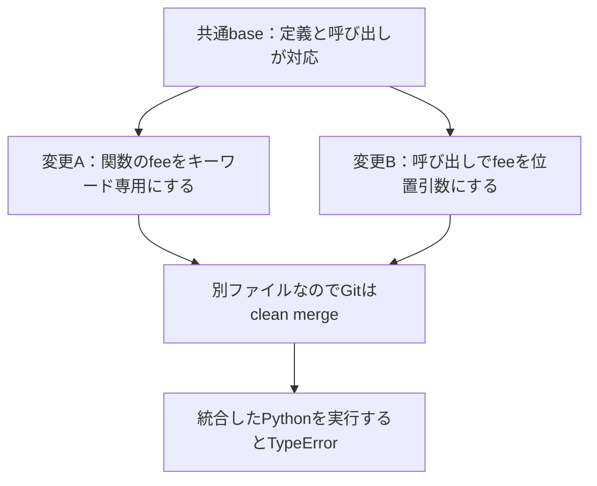

Gitが競合なくマージできても、組み合わせたコードが動くとは限りません。一方、「この2ファイルは関係している」という解析結果が出ても、変更が壊れているとは限りません。

この違いを、自作の解析エンジン[Veripsa Core](https://github.com/RollNuts/veripsa)の4つの合成例で確かめられる形にしました。コードの構造と、Git履歴で一緒に変わった記録を別々に取り出し、実際のマージ・Pythonの実行結果と並べます。

この記事で持ち帰れるのは、次の3点です。

- clean merge、構造上の関係、実行の成功を分けて考える方法。
- Code graphとCo-changeが、それぞれ拾うもの・落とすもの。
- 小さな合成例でも、採点対象とラベルを固定して検証を共有する方法。

GitとPython 3.12があれば、追加パッケージ、モデルAPI、クラウドDB、アカウントなしで試せます。対象は自作の合成コードです。**ここで示す精度は、選んだ4組だけの採点結果で、一般的なバグ検出精度ではありません。**

再現コードから入りたい方は、[固定版の4ケースを試す](https://github.com/RollNuts/veripsa/tree/fcb633eadd9b205a82ed605384def4a9f6189f9d/examples/structural-overlap)こともできます。

## 別々では動き、マージすると壊れる例

デモの共通baseには、次の関数と、別ファイルにある呼び出し側があります。説明用に要点だけ抜き出します。

```python
# billing/pricing.py
def calculate_total(amount, fee=5):
    return amount + fee

# web/checkout.py 側の呼び出し
calculate_total(100, fee=5)
```

ここから、2つのbranchを作ります。

- 変更A：定義を`calculate_total(amount, *, fee=5)`にし、`fee`をキーワード専用にする。元の呼び出しは動く。
- 変更B：呼び出しを`calculate_total(100, 5)`にする。元の定義なら動く。

変更したファイルが別なので、この合成例をGitはclean mergeできます。しかし、キーワード専用になった引数へ位置引数を渡す組み合わせになるため、統合後の実行は`TypeError`になります。



Coreのグラフには、共通baseの時点で、この2ファイルのimportと呼び出しの関係があります。その接点を、実際にGitから取った変更ファイルと照合できます。

ここでCoreが示すのは「この2ファイルを一緒に確認する理由」です。`TypeError`を予測した、と説明することはできません。エラーは、別に行ったPythonの実行で観測しています。[固定版のデモの実装と出力](https://github.com/RollNuts/veripsa/tree/fcb633eadd9b205a82ed605384def4a9f6189f9d/examples/structural-overlap)から、その区別を追えます。

## 出発点は、繰り返すGitコンフリクトだった

作り始めた理由は、開発中にGitのコンフリクトが頻発し、その解消に手間がかかっていたことです。最初から壮大な研究基盤を作ろうとしていたわけではありません。

当時は、将来、複数のAIを並行して使う開発が増えると考えていました。そうなると、変更同士の関係や取り込む順序を調整する必要も増えるだろう、と。ただ、その需要が目に見える形になるまでには、自分の見通しより時間がかかったと感じています。

MCPから使う案も当時からありました。ただ、MCPの問い合わせには、エージェントや周辺の仕組みが呼び出すきっかけが必要です。エージェントが呼び忘れることに頼らず、PRの作成やpushから処理を起動したかったため、GitHub Appのイベント処理を選びました。

AppがMCPより常に優れている、という話ではありません。起動の役割が違います。Appの処理も、サービスの稼働、イベントの受信、正常な実行が前提です。

MCPの収益見通しや、サーバー・DBを運営する負担と収益の釣り合いにも見通しを持てず、積極展開を見送りました。**ホスト型GitHub Appは2026年8月18日から停止中です。今回、再稼働はしていません。**

ここまでの経緯は、作者である私、[RollNuts](https://github.com/RollNuts)の振り返りです。以下の実験結果とは分けて記録します。開発と今回の文書・再現コードの整備には、コーディングエージェントを利用しています。

## 開発の途中で残った、3つの技術

PR同士を調整する処理を作る中で、次の実装が蓄積しました。

| 技術 | 調べること |
| --- | --- |
| Code graph | ソース上のimport、呼び出し、対応するAPI・設定などの接点。対応する構文と解析範囲に依存する。 |
| Co-change | Git履歴で、どのファイルが繰り返し一緒に変更されたか。関係の手掛かりにはなるが、因果関係の証明ではない。 |
| 永続化・増分更新 | グラフ、履歴、対象commit、PRの判断状態を継続して扱う仕組み。Appのイベント処理を支える。 |

今回は新しい検出器を作らず、既存の`code_graph_extract.build_graph`、オフライン評価の粗いファイル間関係、`_cg_cochange.cochange_pairs`を再利用しています。[実装資産の一覧](https://github.com/RollNuts/veripsa/blob/fcb633eadd9b205a82ed605384def4a9f6189f9d/docs/ANALYSIS_ASSETS.md)に入口をまとめました。

ローカルの例がDBなしで動くことは、AppからDBを取り除く方針を意味しません。継続するイベントと判断履歴を扱う層は、別の条件で検証する対象です。

## まず3分で、同じ出力を確かめる

POSIXシェル、Git、Python 3.12を使います。本稿の再現コードは[Core `fcb633eadd9b205a82ed605384def4a9f6189f9d`](https://github.com/RollNuts/veripsa/tree/fcb633eadd9b205a82ed605384def4a9f6189f9d)へ固定しています。macOS／Python 3.12.13で確認した手順で、Windowsでの実行は未検証です。「3分」は読む入口の目安で、処理時間の測定値ではありません。

```sh
git clone https://github.com/RollNuts/veripsa.git
cd veripsa
git checkout fcb633eadd9b205a82ed605384def4a9f6189f9d
git rev-parse HEAD
python3.12 examples/structural-overlap/demo.py
```

clone後のデモには、外部通信、追加パッケージ、モデル呼び出し、GitHub Appは不要です。一時ディレクトリに架空のGitリポジトリを作り、各branchを実行し、実際にマージしてから統合後のPythonを実行します。手元の作業リポジトリをマージするものではありません。

出力JSONは、次の4ケースを含みます。すべてのbranchは単独実行に成功し、マージもcleanになります。

| 合成ケース | Code graph | Co-change | 統合後の実行 |
| --- | --- | --- | --- |
| 関数の契約を変える／履歴1commit | 観測 | 未観測 | `TypeError` |
| 互換性を保って関連コードを変える | 観測 | 観測 | 成功 |
| 無関係なファイルを偶然一緒に編集する | 未観測 | 観測 | 成功 |
| 動的な名前解決で関数を呼ぶ | 未観測 | 観測 | `TypeError` |

先頭のケースは履歴が1commitだけなので、Co-changeの既定の共同変更回数に届きません。残りの3ケースには、14commit中6回、対象の2ファイルを同時に編集する履歴を意図的に作っています。既存producerの主な既定条件は`co >= 5`、`strength >= 0.3`、`lift >= 2`です。

この履歴に、変更branchや後のマージは含めません。共通base以前の情報だけを解析します。未来の共同変更を混ぜて、事前に分かったように見せないためです。

動的な名前解決では静的な接点を拾えなくても、履歴が確認候補を補います。一方、無関係なファイルをまとめて編集する習慣も、同じ履歴の候補になります。ここが、2種類の根拠を分けて残したい理由です。[期待出力JSON](https://github.com/RollNuts/veripsa/blob/fcb633eadd9b205a82ed605384def4a9f6189f9d/examples/structural-overlap/expected-output.json)には、相対パス、根拠の種類、履歴の件数、実行結果があります。

## 「確認すべき関係」をラベルにして採点する

観測結果だけでは、解析を変更した後に何が良くなったか比較しにくいため、4ケースそれぞれの1組を対象に、[別ファイルのラベル](https://github.com/RollNuts/veripsa/blob/fcb633eadd9b205a82ed605384def4a9f6189f9d/examples/structural-overlap/review-labels.json)を置きました。

問いは、「このファイルの組に、機能上、一緒に確認する価値のある関係があるか」です。「統合すると壊れるか」ではありません。

関数を直接呼ぶ2ケースと、同じ関数を動的に読み込むケースを正例、機能上の依存がないbannerとpricingの組を負例にしています。正例3組、負例1組です。互換性を保った変更も、呼び出し関係があるので正例です。

これは、既存の挙動や限界を踏まえて作った合成例です。第三者が独立に選んだ未知のOSSを、盲検で評価した結果ではありません。

採点は、同じローカル環境で実行できます。

```sh
python3.12 examples/structural-overlap/benchmark.py
```

各手法が確認候補に含めたかをラベルと比較し、次の件数を数えます。

- TP：関係があるラベルの組を、候補にした。
- FP：関係がないラベルの組を、候補にした。
- FN：関係があるラベルの組を、候補にしなかった。
- TN：関係がないラベルの組を、候補にしなかった。

Precisionは`TP / (TP + FP)`、Recallは`TP / (TP + FN)`です。分母が0の場合はJSONの`null`にし、満点として扱いません。

実行で得られた[固定の採点結果](https://github.com/RollNuts/veripsa/blob/fcb633eadd9b205a82ed605384def4a9f6189f9d/examples/structural-overlap/expected-scores.json)は次のとおりです。**母集団は、先ほど選んだ4組だけです。**

| 候補にする条件 | TP | FP | FN | TN | Precision | Recall |
| --- | ---: | ---: | ---: | ---: | ---: | ---: |
| Code graph | 2 | 0 | 1 | 1 | 2/2 | 2/3 |
| Co-change | 2 | 1 | 1 | 0 | 2/3 | 2/3 |
| どちらかで観測：union | 3 | 1 | 0 | 0 | 3/4 | 3/3 |
| 両方で観測：intersection | 1 | 0 | 2 | 1 | 1/1 | 1/3 |

JSONでは共通集合を`corroborated`と表記しています。

unionは、動的参照の見落としを埋める一方、偶然の共変更によるFPも残します。両方で観測された組だけに絞ると、この4組では関係のある2組を落とします。「足せば良い」「両方なら正しい」とは言えません。

また、互換性のあるケースは、TPなのに実行が成功します。これは採点の矛盾ではありません。確認する関係の有無を測っていて、失敗を予測していないためです。

このunion／intersectionは、オフラインの候補集合の比較です。AppのPostgreSQL上のPR判定規則ではありません。App側には、歴史的な関連を別枠で知らせるadvisoryと、一部の抑制された静的関係を履歴で裏付ける限定処理があり、一般的なunionで判定する実装とは区別しています。

## 数値を出しても、まだ測れていないこと

4組の採点が再現できることと、実際の開発で有効なことの間には、まだ距離があります。

この実験では、未知のリポジトリに対する一般的なPrecision／Recall、Top-Kの有用性、レビュー時間の短縮、バグや脆弱性の発見能力を測っていません。曖昧なシンボルのケースも、追加のラベルと評価が必要です。動的参照の見落としが1つあることを、不確実性全般を校正できた証拠にはしません。

処理時間とメモリも、本稿では比較可能な性能数値を示していません。入力、解析版、依存、測定範囲を揃えた検証が別途必要です。

既存の[Flaskによる履歴評価](https://github.com/RollNuts/veripsa/blob/fcb633eadd9b205a82ed605384def4a9f6189f9d/docs/OFFLINE_EXAMPLE.md)は、構造上の関係が過去の同時変更と対応するかを、固定した公開checkoutで比較する別の実験です。その相関も、バグ検出や将来の故障の正解ラベルではありません。

解析に出なかった関係は`not_observed`です。「依存なし」や「Clear」へ読み替えません。逆に、候補が増えた場合は、人が読む負担も増え得ます。

## 本文を蓄積しない設計も、境界を明確にする

Coreは解析時にソース本文を読みます。PR調整用の保存・表示層と、今回のデモのJSONでは、ファイルパス、シンボル、構造上の関係、commitやPRの識別情報、判断状態などを扱い、ソースファイル本文やdiff本文を蓄積しない設計にしています。別の監査CLIなどの出力まで、情報を持たないと保証する意味ではありません。

「情報を何も持たない」という意味ではありません。パスや契約名も、開発内容を表す場合があります。今回の公開例は合成入力に限定し、報告には本文や一時ディレクトリの絶対パスを含めません。[データの境界](https://github.com/RollNuts/veripsa/blob/fcb633eadd9b205a82ed605384def4a9f6189f9d/SECURITY.md#content-free-posture)を参照できます。

別の記事では、[Tauriの契約接点を保存snapshotからMCPで読む例](https://zenn.dev/veripsa/articles/tauri-command-contract-graph)を扱いました。そちらの問いは、限定したメタデータをAIへどう渡し、不確実性を残すかでした。今回はMCPを使わず、構造と履歴の候補を、明示したラベルと比較します。どちらも、現在の作業ツリーやマージの安全性を保証するものではありません。

Coreのライセンスは[Business Source License 1.1](https://github.com/RollNuts/veripsa/blob/fcb633eadd9b205a82ed605384def4a9f6189f9d/LICENSE)です。現時点ではsource-availableであり、OSI承認のオープンソースライセンスとは異なります。再利用時は追加利用許諾と変更日を確認してください。

## 自分の反例を、次の回帰テストにする

今の目標は、作者一人で機能を増やすことより、第三者が試して分かったことを、再現できる改善へつなぐことです。今回の整備は参加を受け入れる準備であって、外部の参加実績やコミュニティの成功を示すものではありません。

最初の参加は、コード修正でなくても構いません。

- 本来つながるはずなのに出なかった、または誤ってつながった最小の合成例。
- 定義と利用のどこを見て、期待する関係を決めたかの説明。
- 公開Coreの版、入力の版、Python／parser環境、実行コマンド、実際の結果。

これらがあれば、報告を回帰テストへ変え、修正前後を比較できます。既存の検証は、次のコマンドで実行できます。

```sh
python3.12 -m unittest discover -s tests -p 'test_structural_overlap_demo.py' -v
python3.12 -m unittest discover -s tests -p 'test_structural_overlap_benchmark.py' -v
```

公開済みの固定commitを新しく取得し、追加パッケージのないPython環境で再実行したところ、採点結果は同梱JSONと一致し、デモと採点境界の計26テストが成功しました。これはローカルの対象テストの確認で、全リリーステストやホスト型Appの稼働確認ではありません。

採点器は、元のデモの固定結果を要求するself-checkより前の収集処理を使います。そのため、抽出器の改善後に、以前の見落としを再現しなければ採点できない構造にはしていません。変更の根拠を説明したうえで回帰テストの期待値も更新し、負例や不都合なケースを消さずに比較できます。

最小の反例ができたら、[解析報告フォーム](https://github.com/RollNuts/veripsa/issues/new?template=analysis_report.yml)へ、期待した関係と実際の出力を添えてください。日本語でも報告できます。修正に参加する場合は[CONTRIBUTING](https://github.com/RollNuts/veripsa/blob/main/CONTRIBUTING.md)を参照できます。Issue、テスト、PRの関係を残し、貢献を正確に追えるようにします。記事などでの別途の記名は、本人の希望を確認します。脆弱性の疑いは公開Issueへ書かず、[非公開の報告経路](https://github.com/RollNuts/veripsa/security/policy)を使ってください。

実装と実験は[Veripsa Core](https://github.com/RollNuts/veripsa)、分野ごとの入口と未計測事項は[研究索引](https://github.com/RollNuts/veripsa/blob/main/docs/RESEARCH_INDEX.md)へまとめます。作者は[RollNuts](https://github.com/RollNuts)です。手元で確かめた反例が、次の解析改善につながる形を育てたいと考えています。
