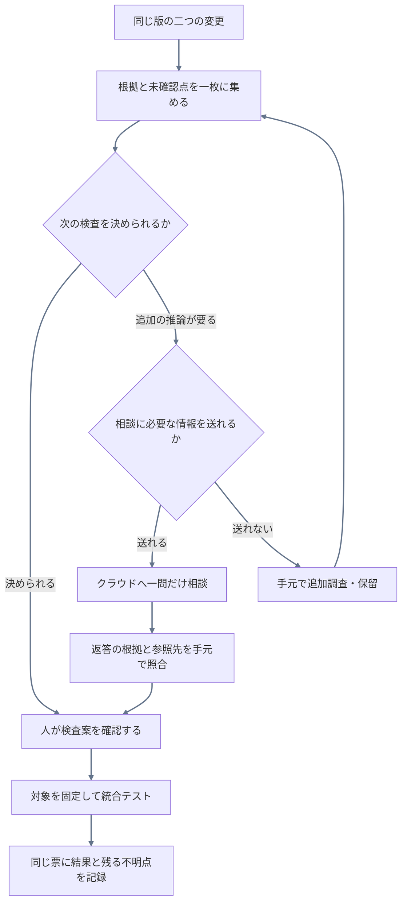
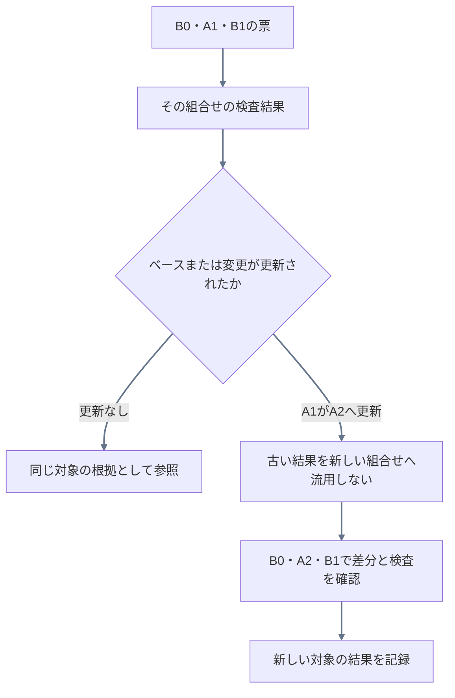
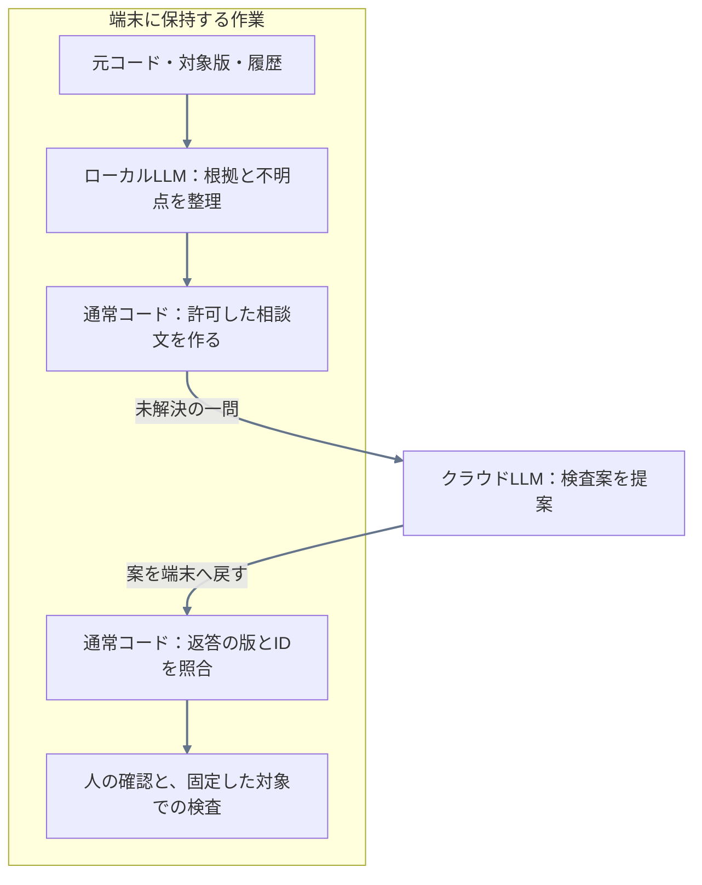

AIに二つの変更を並行で頼んだとします。一方には関数の整理、もう一方には呼び出し側の修正。それぞれから「できました」と返ってきて、テストも通った。Gitにもコンフリクトはありません。

そこで二つを受け取って実行すると、エラーになる。

このとき欲しいのは、もう一通の「私の変更は正しいです」という説明でしょうか。私が欲しいのは、**二つを合わせたときに何が変わるのか、次にどこを確かめればいいのかが分かる一枚**です。

この記事では、AIに並行で作ってもらったコードを受け取る場面を考えます。ローカルLLMには、手元にある変更の意図・コードの関係・不明点をつなぎ、検査計画に整理してもらう。クラウドLLMには、手元で解けない一問だけを相談する。結果は同じ版の同じ組合せへ戻し、実行で確かめる。そのためのハイブリッドLLMの構想です。

最初に、モデルなしで起きる問題を試します。専用の端末や有料APIがなくても、自分の二つの変更について「何を一緒に確かめるか」を書き出せます。

:::message
Microsoft × Zenn「私の考えるハイブリッドLLM～実践と構想～」の構想部門向けです。Surface Laptop Ultraは所有しておらず、ローカルLLMとクラウドLLMの連携・性能比較は未実施です。公開コードで再現できる結果と、これから試したい設計を区別して説明します。
:::

## 別々の成功と、組み合わせた成功は違う

説明用に作った、小さな料金計算のコードです。実サービスで起きた障害を再現したものではありません。

```python
# billing/pricing.py
def calculate_total(amount, fee=5):
    return amount + fee

# web/checkout.py
from billing.pricing import calculate_total

def checkout():
    return calculate_total(100, fee=5)
```

ここへ二つの変更を入れます。

- **PR-A** は、手数料を指定するときに引数名を必須にします。関数定義を `def calculate_total(amount, *, fee=5)` に変更します。
- **PR-B** は、呼び出しを位置引数へ書き換えます。`calculate_total(100, fee=5)` を `calculate_total(100, 5)` に変更します。

PR-Aだけなら、呼び出し側は `fee=5` と名前を指定しているので動きます。PR-Bだけなら、元の関数は位置引数を受け付けるので動きます。変更するファイルが違うため、Gitのマージも成功します。

ところが両方を合わせると、位置引数で渡した `5` を、キーワード専用になった `fee` が受け取れません。

| 実行する状態 | `checkout()` の結果 |
| --- | --- |
| 変更前 | 105 |
| PR-Aのみ | 105 |
| PR-Bのみ | 105 |
| PR-AとPR-B | `TypeError` |

**検査した対象が、PR単独からPRの組合せへ変わった**ことで、結果が変わりました。

二つの変更の単独実行と、組み合わせた実行は、GitとPython 3.12で試せます。新しい作業ディレクトリから、次を実行してください。

```sh
git clone https://github.com/RollNuts/veripsa.git veripsa-hybrid-demo
cd veripsa-hybrid-demo
git checkout --detach 2c6850617bacaaa5cd31e34a490983597a18086d
python3.12 examples/structural-overlap/demo.py
```

取得時にはネットワークを使います。デモの実行には、追加パッケージ、DB、モデル、APIキー、サービスのアカウントは不要です。合成コードを置いた一時的なGitリポジトリを作り、そこで実際に分岐・マージ・Pythonの実行を行います。手元の作業ブランチへ変更をマージする処理ではありません。POSIX環境を対象とし、Windowsでの実行は未確認です。

出力JSONの `function_contract` では、`individual` の二つが `passed`、`git_merge` が `clean`、`integrated` が `failed`、その `error_type` が `TypeError` になります。**例の中で期待した失敗を確認できれば、デモ全体は成功として終了します。** Python 3.12.13で確認した結果と、[固定版のコード・全出力](https://github.com/RollNuts/veripsa/tree/2c6850617bacaaa5cd31e34a490983597a18086d/examples/structural-overlap)を照合できます。

この例だけなら統合テストで答えが出るので、LLMは不要です。続きでは「複数の変更から、何を、なぜ一緒に確かめるのか」を組み立てます。

この先の目次です。まず問題と実測を読み、必要なところから構想や実習へ進めます。

1. [四つのケースで、関係と故障を分ける](#四つのケースから、関係だけでは決められないと分かる)
2. [一枚のレビュー票を、追加観測から実行結果まで追う](#一枚のレビュー票を、未確認から実行結果まで育てる)
3. [ローカルLLMに頼みたい仕事](#ローカルllmには、根拠を検査計画へつなぐ役を頼む)
4. [クラウドに相談する一問と、採らない返答](#クラウドへ送るのは、次の観測を決める一問)
5. [古い版の返答を採らない仕組みを試す](#変更が更新されたら、同じ票でも検査はやり直す)
6. [Surfaceの最小構成と費用](#surfaceに置く最小構成と、いま使える入口)
7. [四方式の比較と、採用しない条件](#四つの方式を、同じ課題で比べる)
8. [自分の二つの変更で始める](#自分の二つの変更でも、一枚から始められる)

## 四つのケースから、関係だけでは決められないと分かる

出発点は、並行作業で起きるGitコンフリクトを減らしたいという悩みでした。そのために作り始めたVeripsa Coreには、コードや変更履歴からファイル同士の関係を調べる処理があります。

他のファイルの関数を呼んでいる、過去に繰り返し一緒に変更されている。これらは、二つの変更を一緒に見るきっかけになります。ただし、組み合わせると壊れるとまでは言えません。

先ほどのデモには、違いを確かめるための四つのケースを入れてあります。すべて説明用の合成ケースで、各変更の単独実行とGitのマージは成功します。

| ケース | コード構造からの関係候補 | 共変更履歴からの候補 | 統合した実行 |
| --- | --- | --- | --- |
| `function_contract`：引数の渡し方が食い違う | あり | なし | `TypeError` |
| `compatible_related`：関係はあるが、呼び出し方は適合する | あり | あり | 成功、205 |
| `unrelated`：機能上無関係な変更をまとめてきた | なし | あり | 成功、105 |
| `dynamic_lookup`：関数を動的に取り出して呼ぶ | なし | あり | `TypeError` |

最初のケースには短い履歴しかありません。コード上の関係はあっても、共変更履歴の抽出条件を満たせません。残りのケースの履歴は、同時に変更した記録を意図的に作ったものです。この表から、実際の開発で壊れる頻度や、一般的な検出精度は分かりません。

それでも、検査計画を作るうえで外せない三つの違いが見えます。

**一つ目は、関係が強そうでも壊れるとは限らないこと。** `compatible_related` では、PR-Aが手数料の既定値を5から7へ変え、PR-Bが金額を100から200へ変えます。呼び出し側は `fee=5` を明示したままなので、統合後は205を返します。コード構造と履歴の両方に候補があっても、この実行は成功します。関係を見つけたら、そこで故障扱いにせず、変更された契約を読みます。

**二つ目は、一緒に変更された履歴が、機能上の依存を証明しないこと。** `unrelated` では、料金計算と表示文言をまとめて変更してきただけです。「よく一緒に直される」という事実から、「片方を直すともう片方が壊れる」とは言えません。履歴は調べる先を示せても、理由までは説明してくれません。

**三つ目は、関係が出なかったことも、安全の証明ではないこと。** `dynamic_lookup` は `importlib` と `getattr` を経由して関数を呼びます。このデモの静的な抽出処理では候補を得られませんが、実際の統合実行では失敗します。出力の `not_observed` は「この方法と範囲では観測されなかった」という意味で扱います。

「この二つを一緒に見る理由は何か」「まだ何が分からないか」「それなら何を試すか」。関係を見つけた後に、この三つをつなぎます。

変更が増えれば、候補の一覧も長くなります。ただし、関係が見つかったペアだけを試せば十分とは限りません。抽出できない関係も、三つ以上の変更で初めて現れる問題もあり得ます。ここでは二つの変更から始め、必須の統合テストは維持します。候補の優先順位と、検査を省いてよいという判断を混ぜない設計にします。

## 一枚のレビュー票を、未確認から実行結果まで育てる

ここからは、四つ目の `dynamic_lookup` を使って構想を具体化します。デモの実行結果はすでに分かっています。その結果をLLMが発見したことにはせず、**結果を知らない段階で、どんな情報を引き継げればそこまで調べられるか**を考えます。

使うのは、対象の版、事実、不明点、次に試すこと、結果をまとめる「レビュー票」です。質問をPR-AやPR-Bのエージェントが別々に持つのではなく、組合せに対して一つ持ちます。

### 最初の票：不明点を、事実の隣に置く

PR-Aは引数をキーワード専用にし、PR-Bは位置引数で呼びます。コードの関係には候補が出ず、履歴には一緒に変更された記録があります。

この段階の票は、次のようになります。B0、A1、B1は説明用の版ラベルであり、実在のコミットSHAではありません。実際に運用するときは、対象を識別できる実際の版を保存します。

| 欄 | 最初に残す内容 |
| --- | --- |
| 対象 | 共通のベースB0、PR-AのA1、PR-BのB1 |
| 変更の意図 | A：引数名を必須にする。B：位置引数で呼ぶ |
| 構造からの事実 | 今回の抽出方法では、変更ファイル間の関係候補なし |
| 履歴からの事実 | 固定したベースまでの履歴に、共変更の候補あり |
| 未確認 | 動的に取り出す関数が、Aで変える関数と同じか |
| 次の候補 | 参照先と呼び出し方を確かめ、同じなら組合せを実行する |
| 実行結果 | まだ記入しない |

「静的に関係がない」と言い切ると、履歴を無視して調査を終えやすくなります。「履歴に関係があるから同じ関数だ」と言い切ると、今度は実際の参照先を調べずに結論へ進んでしまいます。

両方の根拠を残したまま、**不明点を一つの観測へ変える**。この橋渡しを、ローカルLLMや、必要な場合にはクラウドLLMに手伝ってもらいたいのです。

### 次の票：結論を求めず、観測の順を決める

この例で次に必要なのは、「このPRをマージしてよいか」という答えではありません。

1. 固定した版で、実際にどの関数を取り出しているかを確かめる。
2. その関数の受け付ける引数と、呼び出し側の渡し方を照合する。
3. A1とB1を合わせた状態で、対象の呼び出しを実行する。

本稿のために行ったモデルなしの追加検証では、実行中に取り出された関数を観測しました。三つの状態とも `billing.pricing.calculate_total` で、その関数が受け付ける引数と、ソースに書かれた呼び出しは次の組合せでした。

| 状態 | 実行中に観測した関数の引数 | ソースから読んだ呼び出し | 実行結果 |
| --- | --- | --- | --- |
| Aのみ | `(amount, *, fee=5)` | `calculator(100, fee=5)` | 105 |
| Bのみ | `(amount, fee=5)` | `calculator(100, 5)` | 105 |
| AとB | `(amount, *, fee=5)` | `calculator(100, 5)` | `TypeError` |

参照先と関数の引数は実行中の観測、呼び出しのリテラル値はASTからの読み取りです。既存デモのJSONにこの追加情報が出るわけではありません。クラウドに発見してもらった結果でもありません。

[追加観測の補助コードと再現手順](https://github.com/RollNuts/zenn-content/tree/62087fa00f40af8f3755aa3c2ddcb3254de896c5/examples/hybrid-review-ticket#固定coreの動的参照を追加観測する)も公開しました。先ほど取得した固定Coreを指定して実行できます。対象はこの信頼済みの合成ケースで、任意のリポジトリを安全に実行する仕組みではありません。

これで、この固定ケースの参照先という不明点は埋まりました。文字列や設定で参照先が変わる実際のコードなら、その条件は別に確認します。調べた結果が別の関数だった場合も、壊れる筋書きへ合わせず、その観測を票に残します。

### 結果を記入した票：提案と実行を分ける

公開デモの統合実行は `TypeError` になります。これはPythonを実行して観測した結果です。コード構造や共変更履歴が故障を予言したわけでも、クラウドの推論が成功した証拠でもありません。

構想上の票へ結果を戻すときは、たとえば次のように区別します。

| 残す項目 | この例での意味 |
| --- | --- |
| 検査案 | 参照先・引数を照合し、両方を統合して呼び出すという計画 |
| その案を採る理由 | 呼び出し規則の変更が同じ関数へ及ぶか未確認だったため |
| 実行した内容 | 固定した合成ケースで、単独二通りと統合後の実行を比較 |
| 観測した結果 | 単独は成功、統合後は `TypeError` |
| この結果で分からないこと | 他の呼び出し元、別の設定、アプリ全体の適合、LLMの有効性 |

狭いテストの結果をアプリ全体の合格へ広げず、失敗した場合には、どの契約をそろえるかを人が決めます。この例なら呼び出し側に引数名を残す修正が考えられますが、修正後の版には改めて検査が必要です。

最初の票には不明点があり、次に確かめることが加わり、最後に実行結果が入る。この流れを、次のように考えています。



この図の矢印は、モデルが自動的にマージしたり、返答中のコマンドを勝手に実行したりする権限を意味しません。検査案の採用、実行、変更の採否には、それぞれ確認を置きます。

## ローカルLLMには、根拠を検査計画へつなぐ役を頼む

票の作成自体は普通のプログラムでもできます。ファイルの一覧、SHAの保存、条件による候補の振り分けには、LLMは要りません。

試したいのは、形式がそろっていない根拠の読み合わせです。PRの目的、実際の差分、関係図、テストで確認できた範囲を並べても、「この変更目的に対して何が確かめられていないか」は残ります。

たとえば、PRの説明が「呼び出し方法を整理した」だけでも、差分では引数名が消えているかもしれません。別のPRでは「APIを明確にする」と書き、位置引数を受け付けなくしている。この二つを読み、「呼び出しの規則が同じ場所で変わっているので、統合状態を試す」という検査計画へつなぐ役をローカルLLMに頼みたいのです。

それがルールや人による確認より有益かは、まだ測っていません。

| 普通のコードへ任せる処理 | ローカルLLMへ期待する処理 |
| --- | --- |
| 対象版、差分、既存の抽出結果を取得する | 変更の説明と実際の差分を読み合わせる |
| 必須項目・値・参照先の形式を確認する | 食い違う根拠や、残る不明点を言葉にする |
| 許可した情報だけで送信候補を組み立てる | 不明点を埋める検査の候補を提案する |
| 更新時に古い結果を失効させる | 人が確認できる短い説明に整える |

モデルが出した変更意図も、確認済みの事実とは別の欄に置きます。「引数の互換性を保つ修正です」と要約していても、差分と一致しているかを読む必要があります。根拠の行を参照できない説明なら、もっともらしさだけで票を埋めません。

端末には元コード、差分、履歴、実ファイルと仮名の対応、票の変遷を保持します。モデルへは必要な根拠を取り出して渡し、足りなければ範囲を広げます。履歴を読む仕事と、版の一致を判定する処理を、モデルの記憶力にまとめて依存させません。

また、ベース版の関係図だけでは、今回の差分で新しくできる関係や、消える関係を取りこぼす可能性があります。票には「どの版から抽出したか」を残し、差分で追加された参照を別に確認します。全PRを一覧にできたことを、全相互作用を理解したことにはしません。

端末を中心に据えるのは、**根拠を見直す場所と、作業の続きを保持する場所を一つにするため**です。クラウドへ接続できなくても、どこまで調べたかを手元の票からたどれます。

## クラウドへ送るのは、次の観測を決める一問

ローカルで判断しにくいものを、すべてクラウドへ送る構成にはしません。「分からない」と「送ってよい」は別の条件だからです。

最初の `function_contract` のように、引数の不整合が読み取れ、すぐ統合実行できるなら、その検査を進めます。クラウドの返答を待つ必要はありません。逆に、参照先が未解決で調べる順序を決められない、複数の根拠が食い違う、既存テストにない入力を考えたい、といった場合は追加の推論を候補にします。

そこで、動的参照の例なら次の一問を送る構成を考えます。以下は**相談文の設計例であり、実モデルへ送って得た応答記録ではありません**。F01とF02は手元の対応表にある仮名です。

> 対象はベースB0と変更A1・B1です。A1はF01で引数名を必須にし、B1はF02で位置引数の呼び出しへ変えます。今回の静的抽出ではF01とF02の関係候補はありません。履歴では共変更の候補があります。F02は関数を動的に取り出していますが、その参照先がF01かは未確認です。参照先を同じだと仮定せず、何をどの順に観測すれば、この二つを一緒に試す必要性を判断できるか、最小の検査案を一つ提案してください。

この問いへの返答は、内容が正しそうなだけでは足りません。たとえば、次の二つは違う理由で採用を見送ります。どちらも実際のモデル出力ではなく、返答を評価するための例です。

| 仮の返答 | どう扱うか |
| --- | --- |
| 「共変更履歴にあるため同じ関数です。統合テストをしてください」 | 参照先の不明点を根拠なく断定したので採用しない |
| 「参照先と引数を確認し、二つを統合して実行してください」 | 正しい案でも、手元で同じ計画ができていたら追加の価値はない。この問いではクラウドを呼ばない |

今回の小例は、後者の計画を人や定型処理で用意できます。クラウドへの一往復に価値があるかは、既知の検査を言い換えた量ではなく、まだ決められなかった観測を具体化できたかで確かめます。

返答を受け取ったら、次の順に読みます。

1. **対象が戻せるか。** B0・A1・B1と、F01・F02が手元の票に対応するかを確認します。知らないIDを勝手に実ファイルへ推測しません。
2. **事実を増やしていないか。** 「履歴にあるので同じ関数です」と断定していたら、その説明を採用しません。
3. **実行できる観測になっているか。** 「全体を十分にテストしてください」だけでは、今回の不明点を埋める計画になりません。
4. **実行後に何が分かるか。** 一つの呼び出しで確認できる範囲と、まだ調べていない経路を分けます。

モデルのconfidenceは合格の証拠にしません。提案にシェルコマンドが含まれても、その文字列を直接実行する経路は作らず、人が案を確認してから用意した検査や確認済みの手順で試します。

### 問いを区別できないほど削ったら、送らない

送信前には、許可した項目と値だけを普通のコードで取り出す構成を考えています。モデルが「秘密を除きました」と言ったことを、送信許可にはしません。生の差分、ファイル名、構造、変更の要約のどこまで出せるかは、扱う仕事によって違います。

名前をF01やF02へ置き換えても、関係や変更内容そのものに外へ出せない情報が残ることがあります。逆に、必要な違いをすべて消すと、何を相談しているのか分からなくなります。

たとえば「二つのファイルに関係があります」だけなら、引数が必須になったのか、戻り値が数値から文字列になったのかを区別できません。クラウドは一般的な注意点を並べられても、今回どちらを確かめるべきかを選ぶ材料はありません。

**送信できる形にした後も、今回の不明点を問えるか。** 足りなければ手元で続けます。送信を止めても、票の不明点と元の根拠から作業を進められます。

許可条件は別途定める必要があります。項目名だけのチェックでは自由記述の中身を制限できないため、最初は確認した契約変更の分類と許可済みの補足から問いを組み立てます。

## 変更が更新されたら、同じ票でも検査はやり直す

ここまでの流れで、A1とB1の統合実行を確認できたとします。その直後に、PR-Aのエージェントから「指摘を直しました」と、新しいA2が届きました。

A1とB1についての結果は、A2とB1を検査した結果にはなりません。コードを直した本人が「小さな修正です」と説明していても、対象が変わったことは別に扱います。

この失効処理はモデルへ任せず、票に保存した版と現在の対象版をツールで比較します。ベース版が変わったときも同じです。過去の票は経緯として残せますが、新しい組合せの確認済み表示には使いません。



クラウドへ相談している間に変更が進んだ場合も、古い版への返答をそのまま使わず、新しい差分と照合します。返答を受け取れたことと、今回の検査計画に採用できたことは別です。

実装では、元の作業ディレクトリが更新され続ける状態を、そのまま実験対象にしないことも必要です。対象を固定した作業場所を用意し、どの入力を調べ、どの入力を実行したかを保存します。SHAの文字列を票に書いただけでは、実際にそのコードを見た証拠にはなりません。

人が「この結果は今のコードについてのものか」を毎回会話から読み解かずに済むようにする。モデルの整理がうまくても、この対応が崩れれば、受け取った成果物を確かめたことにはなりません。

この受け渡しの一部は、[モデルなしで動く小教材](https://github.com/RollNuts/zenn-content/tree/62087fa00f40af8f3755aa3c2ddcb3254de896c5/examples/hybrid-review-ticket)にしました。冒頭でCoreを取得したディレクトリの一つ上に戻り、別のリポジトリとして取得します。

```sh
cd ..
git clone https://github.com/RollNuts/zenn-content.git zenn-hybrid-examples
cd zenn-hybrid-examples
git checkout --detach 62087fa00f40af8f3755aa3c2ddcb3254de896c5
python3.12 examples/hybrid-review-ticket/demo.py
python3.12 -m unittest discover -s examples/hybrid-review-ticket -p 'test_*.py' -v
```

| 手書きの入力 | 教材で確かめる結果 |
| --- | --- |
| 手元で次の検査を選べる | `local_test_plan`。クラウドへ相談しない |
| 外部への送信が許可されない | `hold_local`。手元で保留する |
| どちらの方法でも関係候補が出ない | `needs_local_observation`。安全とは扱わない |
| 現行版とIDが合う返答 | `inspection_plan_accepted`。内容の確認と実行はまだ必要 |
| A2へ更新した後に届いたA1の返答 | `rejected`。新しい組合せへ流用しない |

10ケースの出力と6件のテストを用意しました。入力の版・根拠ID・返答はすべて手書きで、外部送信やLLMの呼び出しは行いません。実リポジトリの現在版、送信内容の機密性、提案の意味的な正しさは検査していません。**形式を通った返答も、検査計画の候補であってマージ許可ではない**、という境界を試す教材です。

## Surfaceに置く最小構成と、いま使える入口

Surfaceで最初に試したいのは、二つのPR、一つのローカルモデル、一枚のレビュー票です。最初から多数のモデルを常駐させず、公開サンプルで一往復を通します。

端末では、対象の取得と関係の抽出を普通のコードで行い、ローカルLLMが意図・根拠・不明点を整理する。人がそれを照合し、必要な一問があれば、送信前の処理で許可された値だけを選ぶ。クラウドからの検査案を端末へ戻し、対象版と参照先を確かめてから実行する、という順です。



公式コンテストが参照する[参考キット](https://github.com/dahatake/Surface-Laptop-Ultra-RTX-Spark-Vibe-Coding-kit)には、Surface上のLM Studioでチャット・画像・埋め込みを扱うサービスを動かし、MCPから利用してクラウド側と組み合わせる構成が示されています。これは参考キット側の構成です。私の端末で動かした実績ではありません。

本稿で付け加えたいのは、**何を相談中で、どの版まで確かめたかを端末に残し、更新で古くなった結果を失効させる設計**です。

候補モデルは、ローカルがopen-weightの [gpt-oss-20b](https://developers.openai.com/api/docs/models/gpt-oss-20b)、クラウドが複雑な推論やコーディングを用途に含む [GPT-6 Astra](https://developers.openai.com/api/docs/models/gpt-6-astra) です。前者には端末内の根拠を整理する仕事、後者には未解決の一問から検査案を作る仕事を想定しています。

これは性能差を実測して選び終えた組合せではありません。特定のSurfaceでの互換性、メモリ使用量、速度、温度、電力は未確認です。最初はモデルの読み込みと短い票の作成を確かめ、必要な根拠を保持できなければ、入力範囲やモデル候補を見直します。動かせない構成を、将来の最適解として固定しません。

### クラウドの一往復にも、端末内の作業にも費用がある

モデルの利用形態によって、数える費用も変わります。APIを呼ぶクラウド側は入出力と再試行を記録し、端末側はモデルの起動待ち、推論時間、電力、更新や保守を記録します。さらに、人が票を確認する時間を分けて測ります。

通常のテキストAPI単価だけで計算例を作ると、GPT-6 Astraが入力100万トークンあたり10ドル、出力100万トークンあたり50ドルの場合、入力2,000トークン・課金対象の出力500トークンなら、次のようになります。

```text
入力: 2,000 / 1,000,000 × $10 = $0.020
出力:   500 / 1,000,000 × $50 = $0.025
合計:                            $0.045
```

これは実測額ではなく、2026年11月23日に確認した[公式モデル資料の通常単価](https://developers.openai.com/api/docs/models/gpt-6-astra)を使った計算例です。出力は画面に見える文章の長さではなく、推論分を含む課金対象の量として数えます。キャッシュや別の料金条件、ツール料金、再試行、端末の費用は含みません。普段使っているChatGPTやCodexの契約枠と、従量APIの支払いも同一として扱いません。

一問を短くしても、情報不足で三度聞き直したり、返答の確認に長くかかったりすれば、最初の一往復だけで評価できません。票には、最初に送った量だけでなく、追加送信と採否までをまとめて残します。「送信量が減った」と「仕事が軽くなった」を別々に確かめるためです。

### 既存の入口と、これからつなぐ部分

ここまでの構想を、すでに提供している機能と混同しないよう、入口を整理します。

| 入口 | 現在の範囲 |
| --- | --- |
| CoreのローカルCLI・デモ | コードの関係や履歴を調べる既存の入口。冒頭の4ケースは手元で実行できる |
| ローカルMCP教材 | 固定した関係データを、読み取り専用のツールから照会できる。モデル連携なしでも試せる |
| ホスト型GitHub App | 2026年8月18日から停止中。本稿のデモには接続しない |
| GitHub Actionsとの接続 | PR更新を契機に票を更新・失効させる将来の案。ここで動作確認した仕組みではない |

ローカルMCPはモデルがデータを取り出すための入口であって、取得した情報を外部へ送る許可そのものではありません。また、固定データを照会できることは、現在の作業ディレクトリを常に正確に反映しているという意味ではありません。どの版から作ったデータかを票に引き継ぎます。

CoreはBSL 1.1のsource-availableソフトウェアで、OSIの意味でのOSSではありません。[Coreの提供状況と利用条件](https://github.com/RollNuts/veripsa)および[ローカルMCP教材](https://github.com/RollNuts/zenn-content/tree/6c3ef33ab0074ab7895602c46994e98c3d186bca/examples/core-local-mcp)は、利用前に確認してください。

## 四つの方式を、同じ課題で比べる

まず、**今回の四つの小例は、コードを読んで既存のテストを実行すれば確かめられます。これらを解くためにLLMが不可欠だとは主張しません。** 参照先を確認して統合実行するという案も、定型処理で十分かもしれません。それで間に合うなら、モデルによる整理や外部への相談を外します。

### 最初に固定するもの

最初の比較には、公開できるコードと説明だけを使います。同じ課題、同じベースと変更版、同じ利用可能な根拠、同じ送信許可条件を用意し、次の四方式を並べます。

| 方式 | 調べる流れ | 比較で知りたいこと |
| --- | --- | --- |
| 非LLM | 検索・関係抽出・人の計画・統合テスト | 既存の手段で足りるか、確認の負担はどこか |
| ローカルのみ | 手元のモデルが整理と検査案を担当 | 外部の推論なしで必要な計画を作れるか |
| クラウドのみ | 許可された同じ公開情報から検査案を作る | 端末にモデルを載せる複雑さに見合う差があるか |
| ハイブリッド | 手元で票を作り、未解決の一問だけ相談 | 分担で確認の抜けや重複作業を減らせるか |

実際に渡す部分や要約は方式によって変わるため、入力を保存し、モデルと情報省略の影響を区別します。一方だけに答えが分かる情報や、正解入りの票を渡しません。

既知の四例は、接続や記録が壊れていないかの確認に使います。それだけに合わせた案を評価しないため、別の未提示ケースも用意します。事前に「どの関係を調べる価値があるか」と「統合実行で何が起きるか」を分けて定め、検査案を得た後に固定した手順で答え合わせします。関係があるが正常に動く例も残します。

各ケースで、どの根拠を使い、何を見落とし、どこで人が直したかを残します。小さな合成教材で得た精度を、実際の開発全体へ広げません。

### 票と一緒に残す計測

OS、モデル版、量子化、ランタイム、推論設定、固定入力を記録します。時間は、モデルを起動する待ち時間、入力してから案が返るまで、人が確認・修正する時間、テストの実行時間に分けます。初回だけの読み込みと、繰り返し使うときの応答を混ぜません。

クラウドは入出力トークンと再試行を、端末は取得できる範囲のメモリと電力を記録します。電力を測れなければ未測定のまま残し、消費が少ないと推定しません。人の確認も、同じ答えを覚えた後では短くなり得るため、実行順序と、それまでにどのケースを見たかを残します。

品質については、文章が読みやすいかより先に、次を見ます。

- 調べる必要がある組合せや不明点を、根拠なく候補から消していないか。
- 構造や共変更の事実を、依存・故障の断定へ変えていないか。
- 対象版と参照先を、元のコードへ戻せるか。
- 提案された観測で、不明点が実際に一つ埋まったか。
- 計画を直すために、人がどれだけ読み直し、聞き直したか。

「案を返した件数」と「使える検査が増えた件数」は分けます。保留も、必要な保留か、十分な情報があるのに先延ばしにしたのかを各ケースで確認します。

### 採用しない条件を先に置く

許可外の情報を送った、更新前の版の結果を現行の根拠にした、根拠のない参照先を補って検査した。このような失敗があれば、その構成をそのまま採用しません。まず、データの受け渡しと版の扱いを直します。

正しく動いても、増えるのが既知の検査の言い換えだけなら、クラウドへ相談する価値はありません。ローカルLLMの要約を人が毎回作り直すなら、整理を任せる価値も見直します。見落としを増やさずに確認の負担を減らせるか、費用と待ち時間が見合うかを、実際の結果で判断します。

必要な統合テストがすでにあり、それで困っていなければ、既存のCIや、利用条件を満たすリポジトリなら[GitHubのマージキュー](https://docs.github.com/en/repositories/configuring-branches-and-merges-in-your-repository/configuring-pull-request-merges/managing-a-merge-queue)を先に検討します。マージキューは最新のベースと先行する変更を含めて必須チェックを行う既存の仕組みです。本稿の役割は、まだテストになっていない懸念を検査計画にする部分です。その仕事が生じない場面へ、二つのモデルを足す理由はありません。

## 自分の二つの変更でも、一枚から始められる

専用のローカルLLMや有料APIを用意する前に、いま並行している二つの変更を選べます。最初は、自分でコードと結果を追える小さな範囲が向いています。

共通のベースと、それぞれの変更の版を固定します。何を変えたいのか、実際に何が変わったのか、関係する先はどこかを書きます。分からない欄は埋めず、「何を見れば分かるか」まで書きます。

手元で利用可能なツールや人に頼むなら、次の依頼文から始められます。外部サービスへ渡す場合は、その情報を送ってよいことを別に確かめてください。

> PR-AとPR-Bを、同時に適用した状態で確認したいです。両PRのベース版とhead、変更目的、実際の差分、コード上の関係、履歴上の関係、未確認点を分け、一枚のレビュー票に整理してください。事実には参照先を付け、不明な点は不明のまま残してください。次に何を観測すれば、どの不明点が埋まるかを提案してください。マージ可否は断言せず、採用した検査と実行結果を記入する欄を残してください。

票ができたら、文章の完成を作業の完了にはしません。案を一つ選び、元の根拠へ戻り、対象を固定した状態で実行し、結果を同じ票へ記入します。途中で変更が更新されたら、どの結果を取り直すかを確認します。

関係を探すのが大変なのか、説明と差分を照合しにくいのか、次のテストが思いつかないのか。一枚の票で作業を通してから、手元とクラウドの分担を選べます。

AIへ並行して仕事を頼んだ後、受け取りたいのは、それぞれの「できた」だけではありません。**同じ版の変更を合わせて、何を確かめ、何がまだ分からないのか。** その記録を手元に持ち、必要な一問にだけ外部の推論を借りる。まずは二つの変更と一枚の票から、その分担に価値があるかを試したいと考えています。

コードの関係と共変更履歴の違いをさらに追う場合は、[4ケースから確認先を選ぶ検証記事](https://zenn.dev/veripsa/articles/graph-cochange-review-benchmark)へ。情報をどこまで削っても相談が成り立つかは、[仕事のことを全部は話せない。AIにどう相談すればいい？](https://zenn.dev/veripsa/articles/hybrid-llm-send-boundary-design)で扱っています。

記事の構成と執筆、公開サンプルの検証にはAIの支援を利用しています。ここで測ったのは説明用コードの挙動であり、ハイブリッドLLMによる性能・費用・確認時間の改善ではありません。

[Microsoft × Zennコンテスト](https://zenn.dev/contests/zennfes-autumn-2026-microsoft)
