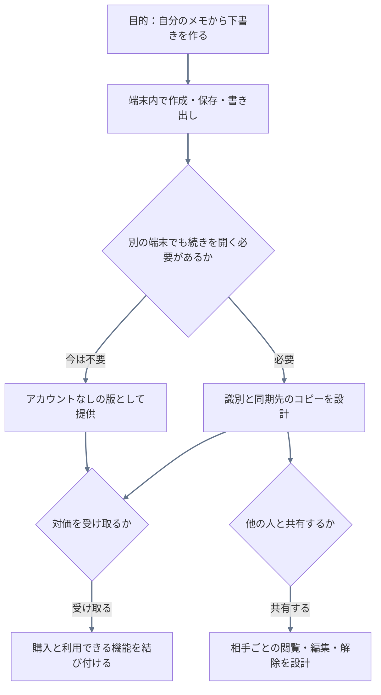
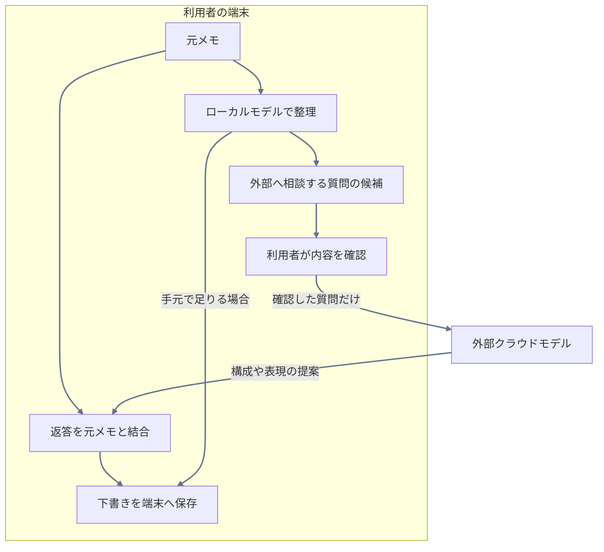
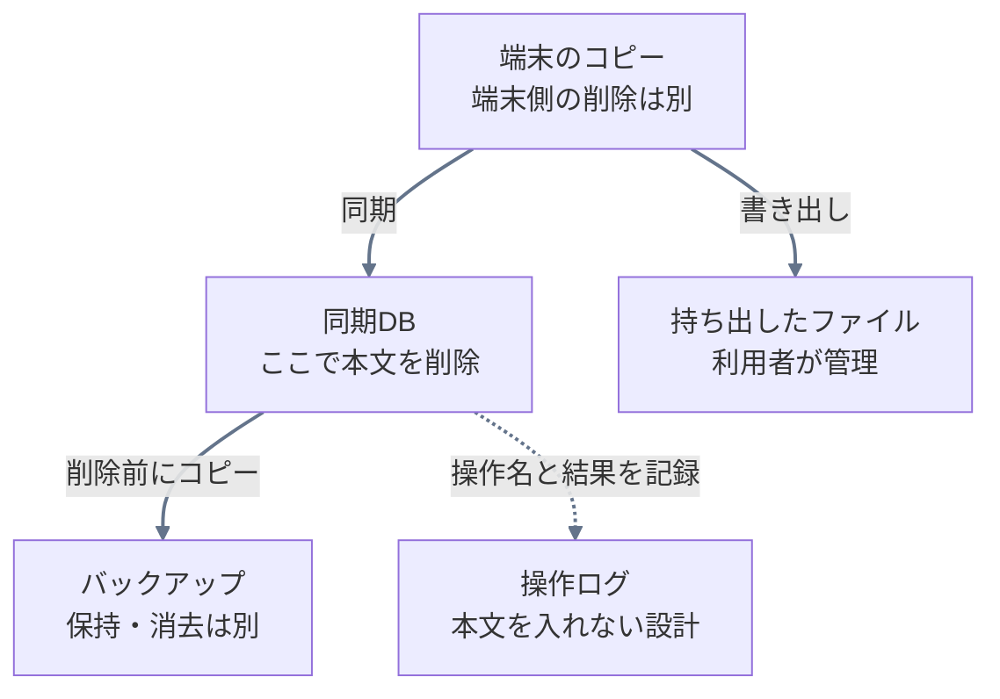

AIを使って、自分のメモから文章の下書きを作る道具を作ったとします。書き散らした内容が整理され、見出しが付き、書き出しの案が出てくる。自分には便利なので、誰かにも使ってもらいたくなりました。

次に欲しくなるのは、ログインでしょうか。別の端末でも続きを開ける同期でしょうか。毎月使ってもらうための課金でしょうか。

その前に、**利用者の何を預かり、いつまで、どう返したり消したりすると約束するのか**を考えます。

文章の下書きを助けるだけなら、元のメモを運営者のサーバーへ保存する必要はないかもしれません。一方、端末をなくしても続きを復元できるようにするなら、どこかにコピーが必要です。料金を受け取るなら、購入と利用できる機能を結び付ける仕組みが要ります。複数人で同じメモを開くなら、誰にどの操作を許すかを決める必要があります。

便利さを一つ増やすと、その後も続く仕事が生まれます。個人開発では、**機能を足す前に、預かるデータと守り続ける約束を選びたい**と考えています。

私なら初版は、元メモを利用者の端末に置き、書き出しを用意します。同期と共同編集は付けず、クラウドには利用者が確認した質問だけを渡す構想です。そこから機能を増やす必要が出たとき、何を引き受けることになるのかを追っていきます。

この記事では、架空の「メモから下書きを作る道具」を、誕生から同期、有料化、退会、サービス終了まで追います。「個人ならここまで安全」という万能な線は引きません。代わりに、自分が提供する機能と、今は提供しない機能を、理由付きで選ぶための設計を考えます。

:::message
Microsoft × Zenn「私の考えるハイブリッドLLM～実践と構想～」の構想部門を念頭に置いた記事です。題材のサービスは架空で、利用実績や需要を検証したものではありません。Surface Laptop Ultraは所有しておらず、端末上のLLMとクラウドの連携・性能比較も未実施です。後半の小さな教材で観測するのは、架空のメモの保存先と操作結果です。
:::

目次は次の通りです。

1. [AIで作る入口が広がった時代に、何を考えるか](#作れる入口が広がった。その先の運営をどう選ぶか)
2. [保存方式と、有料化・共同利用を分けて選ぶ](#保存方式と、有料化・共同利用を分けて選ぶ)
3. [アカウントなしで利用者端末に置く](#最初の版は、利用者の端末だけで使えるか)
4. [利用者の端末とクラウドへ、どの仕事を分けるか](#ローカルとクラウドを組み合わせるなら、誰の端末か)
5. [同期で増えるアカウント・認可・保存先](#同期を足すと、アカウントの向こうに何が増えるか)
6. [小さな教材で、コピーと削除を確かめる](#小さな教材で、増えた保存先を実際に見る)
7. [有料化と本文保管を分け、共同利用を選ぶ](#有料化と、本文を預かることは分けて決める)
8. [ログ、バックアップ、退会、終了までを追う](#「消しました」は、どの保存先までの話か)
9. [障害や問い合わせに対応できる範囲を決める](#困った日にも守れる、サービスの範囲を選ぶ)
10. [自分が引き受ける約束を、一枚にする](#自分が引き受ける約束を、一枚にする)

## 作れる入口が広がった。その先の運営をどう選ぶか

この問いを今考えたいのは、AIを使って作る活動が広がる一方で、公開したサービスには認証、権限、設定、依存する部品など、継続して扱う境界があるからです。

GitHubの『Octoverse 2025』では、LLMのSDKを使う公開リポジトリが110万を超えたと報告されています。LLMをソフトウェアへ組み込む活動が広がっていることを、公開リポジトリから見られます。[GitHub Octoverse 2025](https://github.blog/news-insights/octoverse/octoverse-a-new-developer-joins-github-every-second-as-ai-leads-typescript-to-1/)

一方、2025年の事故や攻撃を基に審議・投票したIPAの『情報セキュリティ10大脅威 2026』では、組織向けに「AIの利用をめぐるサイバーリスク」が初めて選ばれました。AIの利用自体も、運用の中で考える対象になっています。[IPA 情報セキュリティ10大脅威 2026](https://www.ipa.go.jp/security/10threats/10threats2026.html)

OWASP Top 10:2025には、アクセス制御、設定、ソフトウェアの供給経路、認証などの問題が含まれています。誰のデータを誰が読めるか、どの設定や部品で動かすか。AIを組み込むサービスでも、こうした境界を考える必要があります。[OWASP Top 10:2025](https://top10.owasp.org/2025/0x00_2025-Introduction/)

三つの資料は対象が異なります。公開リポジトリ数を稼働サービス数へ、審議結果やランキングを事故の増加率・個人の被害確率へ読み替えることはできません。私はこれらを、開発を始める入口の広がりと、公開後も残る運営の境界を考える材料として参照します。全部の機能を一度に引き受ける前に、自分が扱える範囲を設計できないか、という問いにつながります。

個人開発では、作った人が問い合わせ、更新、障害対応、終了時のデータ処理も引き受けることがあります。「何を持たないか」を先に選ぶことには、その仕事の範囲を具体化する意味があります。

OWASPの保存に関するガイドも、機微な情報をなるべく保存しないことを設計の選択肢に挙げています。ただし、保存を減らすだけで、処理中の送信、端末の問題、認可の誤りまで解消されるわけではありません。ここではまず、**自分の保存先から漏れ得る対象を減らし、残る対象について説明できるようにする**と考えます。[OWASP Cryptographic Storage Cheat Sheet](https://cheatsheetseries.owasp.org/cheatsheets/Cryptographic_Storage_Cheat_Sheet.html#minimize-the-storage-of-sensitive-information)

## 保存方式と、有料化・共同利用を分けて選ぶ

作る道具の目的を、「自分のメモを、書き始められる下書きにする」と決めます。最初からSNSや共有ノートまで作るわけではありません。

まず、メモの保存方式を二つに分けます。

| 保存方式 | 利用者ができること | 扱うデータと約束 |
| --- | --- | --- |
| ① アカウントなし、端末保存 | その端末でメモを整理し、下書きを作って書き出す | 端末内の保存方法と消し方、書き出し方を説明する |
| ② 自分の端末間で同期 | 別の端末でも続きを開く | 利用者の識別、同期先のコピー、閲覧・更新の権限、復元を扱う |

その上で、二つの機能をそれぞれ必要かどうか決めます。

- **有料化**：購入と利用権の対応、請求状態、解約などを扱います。①のまま有料の道具にすることも、②を無料で提供することも考えられます。
- **共同利用**：共有相手の閲覧・編集・解除を扱います。自分の端末間で同期したいことと、他人と共同編集したいことは別の要望です。

すべてを備えた形を完成形とせず、欲しい便利さごとに選びます。



たとえば、「文章を一度作ったら、ふだん使うエディタへ移したい」という人にとっては、履歴をサーバーへためるより、書き出しが確実な方が役に立つかもしれません。これはまだ需要の仮説です。使う人に確かめる前に、「同期と会員登録があるのが完成形」と決めないようにします。

ここからは同じ利用者が一つのメモを書いたと考え、便利さが増えるたびに、そのメモと関連情報がどこへ移るかを追います。

## 最初の版は、利用者の端末だけで使えるか

①では、メモの元本文と下書きを**利用者自身の端末**へ置きます。ここでいう端末は、運営者の開発用PCではありません。運営者のPCで処理してサーバーへ送らないだけなら、利用者から運営者へ本文を渡していることに変わりはないからです。

最初に用意する操作は、メモの入力、見出しへの整理、下書きの作成、保存、書き出し、削除です。モデルを使わなくても、箇条書きを並べ替えたり、決めた形式へ整えたりする版から始められます。端末上で動くモデルを使う場合も、元本文をどのアプリが読み、どこへ保存するかを確認します。

「この端末で保存できます」と「端末をなくしても復元できます」は、別の機能です。この版では、運営者が元メモのコピーを持たないなら、運営者へ連絡しても失ったメモを返せません。利用者が自分でファイルを書き出せるようにし、保存場所とバックアップの範囲を説明します。

ここには便利さの交換があります。会員登録なしで試せる代わりに、自動の端末間同期はしない。運営者に本文を預けなくてよい代わりに、運営者による本文の復元も提供しない。これは欠陥を言い換えたものではなく、どの機能を提供するかという選択です。利用者が知らないまま期待してしまうと困るので、使い始める前に分かるようにします。

### 「アカウントなし」でも、情報の所在を確認する

ログイン画面をなくしても、道具をWebから配信すれば、その配信経路で扱われる情報があります。問い合わせフォームを置けば、利用者が本文や連絡先を送ってくることもあります。アプリのDBだけを見て「何も預かっていない」とは言えません。

たとえばCloudflareのHTTPリクエストログの資料には、クライアントIP、リクエスト先のURI、User-Agentなどの項目が示されています。すべての環境でこれらが必ず保存されるという意味ではありません。自分が使うCDNやホスティングについて、どの設定で何を受け取り、誰がいつまで参照できるかを確認する必要がある、という例です。[Cloudflare HTTP requests dataset](https://developers.cloudflare.com/logs/logpush/logpush-job/datasets/zone/http_requests/)

そこで①の時点でも、次のような所在表を作ります。下表はこの架空サービスで確認する対象であり、実際の稼働環境を調査した結果ではありません。

| 情報 | この版で置きたい場所 | 別に確かめる場所 |
| --- | --- | --- |
| 元メモ、下書き | 利用者端末 | 自動保存、端末のバックアップ、共有端末での見え方 |
| 書き出したファイル | 利用者が選んだ場所 | 利用者が選ぶ同期先や共有先 |
| アプリを開いた記録 | 必要な範囲の配信基盤 | CDN、ホスティング、分析ツールの設定 |
| 不具合の報告 | 運営者の問い合わせ先 | メールやサポートサービスに添付される本文 |
| クラッシュなどの記録 | 必要と決めた診断先 | 入力本文や画面の内容が混ざらないか |

機能の利用回数だけを知りたいなら、元メモや全文の操作履歴まで送る必要はないはずです。一方、少ない記録で不具合を調べられない場合は、足りない情報と追加で受け取る情報を具体的に選びます。

端末保存にも課題は残ります。端末を共用する人への配慮、保存領域を消した場合の挙動、配布するアプリや依存部品の更新などです。運営者のサーバーへ本文を置かない構成でも、利用者の端末で動くコードが本文を読めるなら、そのコードを届ける経路は大切です。「ローカル」という言葉だけで、これらを終わったことにはしません。

### 自分の設計でも、本文を持たない範囲を言葉にする

私が開発するVeripsa Coreでも、ソース本文や差分本文を永続化しないという設計意図を置いています。ただし、[固定版のSECURITY.md](https://github.com/RollNuts/veripsa/blob/2c6850617bacaaa5cd31e34a490983597a18086d/SECURITY.md)が説明するように、解析時には本文を読み、パス、シンボル、行範囲、構造上の関係、コミットSHA、PRの作者ログインなどのメタデータは扱います。`content-free` は無情報を意味せず、漏洩がなかったことの証明でもありません。この考え方をサービスへ移すときも、「何の本文を、どこへ残さないのか」と「それでも何を扱うのか」を一緒に書く必要があります。

## ローカルとクラウドを組み合わせるなら、誰の端末か

この版では、運営者が元メモを蓄積しないという約束を先に選びました。その約束を保ちながらLLMを使うために、元メモを読む仕事と、追加の文章構成を考える仕事を分けられないか、と考えます。

構想の中心に置くのは、**利用者端末のローカルモデル**です。運営者のサーバーで小さなモデルを動かす構成とは異なります。元メモは利用者端末に残し、ローカルモデルが論点や構成の候補を作る。その中から利用者が外部へ相談してよい質問を確認し、クラウドからの返答を、再び端末内で元メモと結合します。



たとえば、元メモには相手の名前、具体的な事情、日付があり、丁寧な断りのメールを作りたいとします。クラウドへ相談する候補を「依頼を断るが関係は続けたい。理由と感謝をどう並べると伝わりやすいか」という構成の問いにし、具体的な事情の差し込みは端末側で行う、という案です。

この分担で十分な下書きができるかは、実際に試す必要があります。一般的な構成しか返らず、手元で作る方が早いかもしれません。利用者が問いを確認する手間もあります。名前を消せば送ってよいとも限らず、要約に事情が残ることもあります。だから、ローカルモデルの出力を無条件に外へ流すことはしません。

外部クラウドは送られた質問を受け取るため、利用形態や設定、条件を確認します。「運営者のDBに保存しない」を、「誰にも情報を渡さない」と表示しないようにします。

### Surfaceは、最初に自分が試す端末として考える

Surface Laptop Ultraを入手できたら、最初は作者である私自身が一人の利用者となり、公開してもよい架空メモでこの流れを試したいです。まず、端末で元メモを開き、ローカルモデルを起動し、下書きの保存まで行う。次に一つの質問だけクラウドへ送り、返答を手元へ戻します。

ローカル候補にはopen-weightの [gpt-oss-20b](https://developers.openai.com/api/docs/models/gpt-oss-20b)、クラウド候補には [GPT-6 Astra](https://developers.openai.com/api/docs/models/gpt-6-astra) を考えています。前者には端末内での整理、後者には追加の構成や表現の提案を想定していますが、この組合せの性能や費用の優位は測っていません。特定のSurfaceで動く構成、必要なメモリ、速度、電力もこれから確かめる対象です。

この試作が動いても、すべての利用者が同じ端末やGPUを持っているとは限りません。別の端末でも利用できる範囲、モデルを導入できない人の入口、ダウンロード量や初回の待ち時間を考える必要があります。性能が足りないときに、黙って全文をクラウドへ送る代替経路は設けません。ローカル処理の範囲を狭くする、非LLMの機能にする、利用者が分かる形で別の方式を選ぶ、といった仕様にします。

### 四つの方式を、同じ文章作成の課題で比べる

最初の比較では、同じ架空メモと同じ完成条件を用意します。たとえば「必要な事実を落とさず、見出しと書き出しがある下書きにする」と決め、次の四方式を試します。

| 方式 | 利用形態 | 確かめたい費用・性能・使い勝手 |
| --- | --- | --- |
| 非LLM | 定型の整理、検索、手動編集 | この道具の目的は、そもそもモデルなしで満たせるか |
| ローカルのみ | 利用者端末にモデルを置く | 起動と応答、メモリ、電力、導入負担、下書きを直す量 |
| クラウドのみ | 許可された同じ公開入力を外部へ送る | 送信量、API費用、待ち時間、再試行、下書きを直す量 |
| 併用 | 手元で整理し、確認した質問だけ外部へ送る | 追加の提案が、確認と往復の手間に見合うか |

利用者が自分の情報を送りたくない条件では、クラウドのみの方式を選べないことがあります。最初の比較は公開可能な架空メモで行い、実際の提供では「どの情報をどこへ出せるか」という条件を先に置きます。

モデル名や設定、入力、送った質問、返答、最終的に人が直した箇所を保存します。待ち時間は初回の読み込みと繰り返し利用を分け、クラウドの入出力と再試行も含めます。端末の電力を測れなければ未測定とし、ローカルの方が安い、あるいは併用の方が高品質と先に決めません。

とくに見たいのは、下書きが長くなったかではなく、元メモにない事実を加えていないか、必要な内容が抜けていないか、利用者が直す負担が減るかです。クラウドから定型文が増えるだけなら、その問い合わせをなくします。ローカルの整理だけで十分なら、その版を提供する方が扱いやすいかもしれません。

### クラウドの料金を、誰が支払うか

同じ外部モデルを使っても、利用者自身がAPIキーを用意する方式と、運営者が中継する方式では、扱うものが変わります。

| 方式 | 利用者側に生じること | 運営者側に生じること |
| --- | --- | --- |
| 利用者が自分のAPIキーを使う | 対応する契約、料金、使用量、キーの設定・失効を管理する | キーをどこへ保存し、どの処理が読めるかを設計・説明する |
| 運営者のサーバーでAPIを中継する | 自分でAPI契約をしない入口を用意できる | API費用、利用量の制御、濫用対策、送信内容が通過する経路を管理する |

前者はBYOKと呼ばれる形です。利用者自身の料金が発生し得るので、サービスの利用料だけで総費用を説明しないようにします。また、「利用者のキーだから運営者は無関係」とも言えません。アプリがどこにキーを置き、診断情報や同期に混ぜないか、誰のコードが読めるかを確かめる必要があります。

後者では、運営者のAPIキーを利用者の画面へ配らずに中継する構成を考えられます。その代わり、運営者は外部APIの費用と不正利用への対応を引き受け、質問は運営者のサーバーも通ります。中継する本文を保存しない方針でも、処理中には扱い、ログやエラー報告へ混ざる経路がないかを確認します。

これはどちらが常に安全、という比較ではありません。①の「端末で使う道具」に、運営者が何を追加するかの比較です。最初の試作では、自分の架空メモと利用可能な範囲で分担の有用性を確かめ、利用者向けの課金経路やキー管理を実装済みとはしません。

## 同期を足すと、アカウントの向こうに何が増えるか

道具を使う人から「PCで書き始めた続きを、スマホでも書きたい」と言われたとします。ここで初めて、②の同期を考えます。

同期が欲しい理由は、ログイン画面を通りたいからではありません。自分のメモを、正しい相手として、別の端末から取り出したいからです。必要なのは、その目的を満たすための識別と、コピーの置き場所と、操作を許す範囲です。

元メモまで同期するのか、完成した下書きだけでよいのか、設定だけを同期するのか。この違いで、預かる内容は大きく変わります。ここでは違いを見るために、元メモと下書きの同期を追加すると仮定します。運営者の同期サーバーに本文のコピーを置くなら、①の「元本文は利用者端末に置く」という説明を、そのまま使い続けることはできません。

### ログインの確認と、メモを読んでよいかの確認

外部サービスでログインしてもらえば、本人を識別する仕組みの一部を任せられます。ただし、ログインできた人が、アプリ内のどのメモを読めるかは別の話です。

この道具では、利用者Aが作ったメモを、利用者Bのセッションから読めないことが必要です。画面に他人のメモを表示しないだけでなく、データを返す側で、その操作を許してよいかを確認します。ブラウザから渡された「私はAです」という値だけを、その根拠にしない設計にします。

IPAの資料も、認証に加え、利用者ごとに閲覧や変更の権限を制御することを説明しています。認証は「誰として利用しているか」、認可は「その人がこの対象へ何をできるか」と分けると、この道具で確認すべきことが見えてきます。[IPA 認可制御の欠落](https://www.ipa.go.jp/security/vuln/websecurity/access-control.html)

同期の読み取りだけでなく、更新、削除、書き出しでも同じ相手のデータを扱います。Aが自分のメモを消せることと、BがAのメモを消せないことを、両方確かめます。共有機能をまだ提供しないなら、共有できる権限を先に作っておく必要はありません。

### アカウント情報は、項目ごとに理由を持つ

外部認証を使う場合でも、自分のアプリで利用者とメモを結び付ける識別子は必要になり得ます。OpenID Connectでは、発行者とsubjectの組が利用者の識別に使われます。氏名やメールアドレスを保存しなくても、この識別子で同じ利用者の履歴を結び付けられるなら、ただの無関係な文字列として扱わない方がよいでしょう。[OpenID Connect Core 1.0](https://openid.net/specs/openid-connect-core-1_0.html#ClaimStability)

この道具で検討する項目は、たとえば次のようになります。保存が必要かどうかは、採る認証方法や提供する機能に合わせて決めます。

| 項目 | 何のために使うか | 機能を選ぶときの問い |
| --- | --- | --- |
| アプリ内の利用者ID、外部認証との対応 | メモの持ち主を結び付ける | 同じ利用者をどう識別し、退会でどう扱うか |
| 表示名、アイコン | 画面上で誰の情報か示す | 個人だけで使う版に必要か、任意にできるか |
| メールなどの連絡先 | 必要な通知や問い合わせ対応 | 認証事業者・決済事業者の情報を、そのまま複製する必要があるか |
| セッションに関する情報 | ログイン状態と終了を扱う | どこが管理し、ログアウトや失効でどう終わるか |
| メモと所有者の対応 | 閲覧・更新・削除を制御する | すべての操作で、同じ権限の条件を使えるか |

利用者のプロフィールを豊かにすることが、この道具の目的とは限りません。誕生日や住所など、機能で使わない項目を「あとで役立つかも」で増やさない。一方で、連絡先を一切持たないと決めるなら、問い合わせや復旧の入口をどう提供するかも考えます。

パスキーを選ぶ場合も、本文や購入履歴をどこまで保有するかは別に決めます。公開鍵による認証方式を選んだことで、アプリが保存するメモまで消えるわけではありません。認証方式の良し悪しと、サービスが持つ情報の範囲を一つの判断にまとめないようにします。[W3C WebAuthn Level 3](https://www.w3.org/TR/2026/REC-webauthn-3-20260825/)

認証サービスを外部へ任せるときは、どのセッションや情報を相手が管理し、どれを自分のアプリが管理するかも確認します。OWASP ASVSでは、認証、セッション、認可、データ保持、ログは別々の検証対象として扱われています。外部のログインが成功しただけで、同期サービス全体の確認を終えないための整理として参考になります。[OWASP ASVS 5.0.0](https://github.com/OWASP/ASVS/tree/v5.0.0/5.0)

## 小さな教材で、増えた保存先を実際に見る

架空のメモ一つで確かめる[教材のコードと説明](https://github.com/RollNuts/zenn-content/tree/07698b55e1bee2957b0ff494dcaf491107b6277f/examples/minimal-custody)を用意しました。新しい作業ディレクトリから、Gitで固定版を取得して実行します。教材はPython 3.12と標準ライブラリだけで動き、追加パッケージ、アカウント、モデル、APIキーは使いません。

```sh
git clone https://github.com/RollNuts/zenn-content.git zenn-custody-demo
cd zenn-custody-demo
git checkout --detach 07698b55e1bee2957b0ff494dcaf491107b6277f
python3.12 -B examples/minimal-custody/demo.py
python3.12 -B -m unittest discover -s examples/minimal-custody -p 'test_*.py' -v
```

2026年11月23日に、固定版を新規取得した環境で独立して追試し、Python 3.12.13・SQLite 3.50.4でデモと8件のテストの成功を確認しました。取得後の教材実行は外部へ通信しません。

教材では、端末、運営者のサーバー、バックアップを、**同じ一時ディレクトリ内の別ファイル**で模擬します。ネットワークで同期するアプリではありません。元メモはコード中にある架空の文字列だけで、利用者のファイルを読み込む機能はありません。

本文には追跡用の目印を入れてあります。目印を含む本文が、各段階でどこから読み出せるかを確かめると、次の変化が見えます。

| 段階 | 観測すること | この結果から読める範囲 |
| --- | --- | --- |
| 端末にだけ保存 | 端末のファイルは本文と一致し、サーバー役のDBはまだない | この段階ではサーバー役へ本文を保存していない |
| 同期を追加 | サーバー役のSQLite DBから本文を読める | 運営者側を模した保存先にもコピーが増えた |
| 別の利用者として読取り・削除 | 本文を返さず、削除も行わない | この教材の所有者条件で、他者の操作を拒否する |
| 本人としてサーバー側を削除 | 稼働中のDBへのSQL読出しで本文を得られない | 稼働中の読出し先からは取れなくなった |
| 削除後に別の保存先を確認 | 事前のバックアップと端末には本文が残る | 一か所の削除では、別のコピーまで消えていない |
| 操作ログを確認 | 固定した操作名と結果だけがあり、本文の目印はない | このログ関数には本文を記録していない |

出力の一部です。`live_read_unavailable` が `true` なので稼働中のDBからは読めず、それでもバックアップと端末の本文は元の文字列に一致しています。

```json
{
  "after_live_delete": {
    "live_read_unavailable": true,
    "backup_body_matches": true,
    "device_body_matches": true
  }
}
```

ここで利用者の判別に使う値は、信頼できるセッションから得た所有者IDを**模した引数**です。教材にはログインやセッション検証がなく、呼び出し側は任意のIDを渡せます。したがって、他者の操作を拒否できた結果は、本番の認証や権限管理を実装・検証した証拠にはなりません。対象のメモと所有者の両方を条件にする、保存処理の一部分を取り出して見ています。

暗号化も実装していません。同期後のSQLiteファイルには、本文の目印をそのまま観測できます。また、SQLで読めなくなったことと、ディスクから復元不能になったことは別です。終了時に一時ディレクトリを削除する処理も、完全消去の検証にはしていません。

この小例で確かめたいのは、守る技術の優劣より前にある、**機能を一つ足したことで、本文を持つ場所が一つ増える**という変化です。ログイン画面の見た目は同じでも、同期とバックアップによって、運営者が扱うコピーは増えます。その変化を仕様へ戻します。

たとえば②を提供するなら、利用者への説明を「端末に保存されます」だけで終えず、同期先にも保存することを伝える。削除機能には、稼働中のコピー、バックアップ、利用者端末のコピーの範囲を分けて書く。教材の結果を、そのまま本番の安全宣言にせず、確認する保存先を見つける材料にします。

## 有料化と、本文を預かることは分けて決める

道具を続ける費用を賄いたくなり、有料化を考えたとします。ここで「有料サービスだから会員登録と本文の保存が必要」と、まとめて足さないようにします。

対価を受け取る理由は、便利な道具や機能を提供することです。利用者の元メモを運営者が保管すること自体が、購入したい価値とは限りません。端末内で作成して書き出す版について、購入した機能を使えるようにする形も考えられます。ただし、それが売れるかは需要の検証が必要で、「持たない設計だから売れる」とは言えません。

料金を取る場合は、本文の代わりに何も扱わなくなるわけではありません。購入が成立したことと、誰またはどの利用環境へ機能を提供するかを結び付け、解約や返金などで状態が変わったときも反映する仕組みが要ります。

### 支払いの情報と、下書きの情報を別の表に置く

カードなどの支払い手段は決済事業者が受け取り、自分のアプリは購入と利用権に必要な情報だけを受け取る構成を検討します。具体的に何が返り、何を保存するかは、その決済連携で確認します。

Stripe Checkoutの資料では、Customerオブジェクトを作成しない場合でも、入力されたメールアドレスや住所などを `customer_details` から取得できると説明されています。「自分のアプリに会員登録を作らない」「決済事業者にCustomerを作らない」「購入に関する情報がない」は、同じ意味ではありません。[Stripe Checkout Sessionの作成](https://docs.stripe.com/api/checkout/sessions/create)

この道具では、次のように役割から考えます。

| 情報 | 使う場面 | このサービスで決めること |
| --- | --- | --- |
| 支払い手段に関する情報 | 決済の実行 | どの事業者が受け取り、自分のアプリを通る範囲はどこか |
| 購入・契約の識別子 | 支払状況の照合、問い合わせ | 本文と結び付けずに対応できるか |
| 利用できる機能と有効な状態 | 有料機能の提供 | 購入、更新、解約などの変化をどう反映するか |
| 必要な連絡先 | 購入に関する案内や対応 | 誰が保持し、運営者が複製する必要があるか |
| 元メモと下書き | 文章を作ること | 課金のために保管する必要はなく、同期の判断と分ける |

「購入した機能が使えない」を調べるなら、私的な元メモより、契約の識別子、アプリの版、発生した状態を確認できることが大切です。必要な確認情報まで減らしすぎて、購入者へ対応できない構成にもしたくありません。

有料化の仕様には、使えない時間が生じた場合の案内、解約後に何が使えるか、書き出しをどう扱うかも含めます。すべてを高度に自動化してから始める必要はなくても、人がどの手順で対応するかは用意します。支払いに関係する条件や必要な記録も、採る方式に合わせて確かめます。

### 複数人で使う機能は、さらに別に選ぶ

次に、「この下書きを共同編集したい」という要望が来たとします。これは有料化の付属品ではありません。②では一人の持ち主だったものへ、共有相手と権限を加える変更です。

たとえば、持ち主は共有を解除できる、招かれた人は読むだけか編集もできる、退会した相手は以後アクセスできない、といった動きを決めます。どちらかが文章を書き出した後、その相手の手元にあるコピーまでサービスから消せるとは限りません。画面上の共有解除で止められる範囲を説明する必要があります。

共同利用を始めると、問い合わせも変わります。「自分の下書きが消えた」に加えて、「相手の修正が反映されない」「共有を外したのに見えている」「持ち主が退会した」が起こり得ます。誰の操作をどの範囲で記録し、どこまで戻せるようにするかを決めます。

ここまで引き受ける準備がなければ、最初はファイルを書き出して各自の道具へ渡すだけにする選択もあります。共同編集を付けないことで失う便利さと、残せる運営の範囲を比べます。利用者が実際に求めているのが「共有して見てもらう」だけなら、共同編集そのものが必要かも確かめられます。

## 「消しました」は、どの保存先までの話か

利用者が、一つのメモを削除したいとします。画面から消え、通常の一覧にも出なくなりました。ここで「消しました」と説明するとき、どこまでを指すのかを考えます。

教材では、稼働中のDBから読めなくなった後も、事前に作ったバックアップと端末のファイルに本文が残りました。実際のサービスでも、本文のある場所を一つずつ確認しなければ、画面から消えたことだけで全体の状態を説明できません。



この図は、同期と削除の考え方を説明する構想です。バックアップの期限管理や、全端末への削除通知を教材が実装しているわけではありません。

### バックアップは、復元の約束とセットで考える

バックアップを持つのは、障害や誤操作から戻せるようにするためです。その便利さを提供するなら、どの範囲をどの期間保持し、誰が復元できるかを決めます。一方で、削除した情報もバックアップに残るなら、その期間を「すぐ完全に消えます」という説明と両立させることはできません。

ここで「全部を即時に物理消去する」と先に書いてしまうより、実際の基盤が何をできるかを確かめます。稼働中のDBから削除する時点、バックアップから除かれる時点、利用者が自分で書き出したコピーの範囲を分け、実現できる内容を説明します。

復元するときも、古いデータが戻ればそれで完了とは限りません。削除済みのメモや退会済みの利用者まで戻してよいか、同期していた端末から古いコピーが再送されないかを確認します。削除処理を一度動かすだけでなく、その後の復旧や再同期と合わせて考える必要があります。

### ログへ残したら、本文とは別の保存先になる

不具合を調べるために、受け取ったデータを丸ごとログへ出したくなることがあります。そうすると、本文の保管をやめたつもりでも、診断用の保存先へコピーを作ってしまいます。

教材の操作ログは、本文を受け取らず、操作名と結果も固定候補だけにしています。そのログに架空本文の目印がないことを確認します。ただし、これはそのログ関数についての結果です。本番のフレームワーク、例外表示、通信の中継、クラッシュ報告などが同じように扱うことは、別に確かめなければなりません。

ログを減らしすぎて、失敗した操作を調べられないこともあります。必要な記録を、目的から選びます。この道具なら、本文を記録する前に、どの操作が、どの版で、どの結果になったかを記録して調べられるかを試します。持ち主や購入と結び付く識別子を記録する場合も、閲覧できる人と保存期間を決めます。

「本文なしのログ」と書くときも、アプリの一か所だけを見ないようにします。アカウントなしの版で確認したCDNやホスティング、外部の診断サービスも含めて、所在表を更新します。

### 退会は、ログインを消すだけでは終わらない

利用者が退会するときは、利用者ID、メモ、共有関係、端末間同期、購入・契約、問い合わせの記録が関わります。外部認証との紐付けを外しただけでは、これらが同時に消えるとは限りません。

この道具では、まず何を退会と呼ぶかを決めます。新しいログインを止めるのか、進行中のセッションも終えるのか、同期データを削除するのか、書き出しの機会を設けるのか。課金を続ける状態が残らないかも照合します。必要な取引記録と私的な本文を同じ保存期間へまとめず、それぞれ何のために残すかを説明します。

バックアップや問い合わせへの添付など、その場で同じ方法では消せない保存先があるなら、その扱いも決めます。できていないことを隠して「アカウントは完全に消えました」と表示するのではなく、止めた機能と、残る情報の扱いが分かる案内にします。

始めるときの所在表に、最後の列を一つ足すと整理できます。

| 情報 | 通常利用での目的 | 終了時に確かめること |
| --- | --- | --- |
| 元メモ・下書き | 作成と同期 | 取得停止、書き出し、削除、端末コピーの範囲 |
| 同期用の識別・セッション | 本人のデータを取り出す | 認証連携と自分のアプリの両方で終わるか |
| バックアップ | 障害からの復旧 | 保持する期間と復元時の削除状態 |
| 操作・診断ログ | 障害や操作の確認 | 本文の混入、参照権限、保持する目的と期間 |
| 購入・問い合わせの記録 | 利用権や問題への対応 | 本文と分けた保有範囲、課金停止、対応窓口 |

それぞれの所在と目的を確かめ、利用者へ説明できる約束にします。

## 困った日にも守れる、サービスの範囲を選ぶ

同じメモを追ってきたことで、最初には見えなかった仕事が出てきました。自分の端末にだけ置く版なら、運営者が本文を復元する仕事は引き受けません。同期する版なら、コピーの状態と権限を確かめる仕事が増えます。有料化すれば、購入と使える機能の不一致に対応する仕事が増えます。

どこまで提供できるかは、利用者が何人までなら安全、という数だけでは決まりません。何を保存し、何種類の権限があり、何を復元すると約束し、困ったときにどう対応できるかを見ます。この道具についても、本文を端末に置く一人用の版と、組織で共同編集する版では、同じ利用者数でも確認する範囲が違います。

### 問い合わせで、あとから本文を集めない

端末内で使う版に、不具合の問い合わせが届いたとします。運営者が「調べるのでメモを全部送ってください」と毎回頼めば、設計では預からなかった本文が、メールやサポート窓口へ集まります。

最初は、アプリの版、行った操作、表示された結果、本文を含まないエラー情報から調べられるようにします。利用者が現象を再現できるなら、私的な文章を架空の短い例へ置き換えても同じ現象が出るかを確認してもらう入口も考えられます。

実際の内容を受け取る必要がある場合は、その場で別の受け渡しが始まったと扱います。何を受け取り、誰が参照し、いつまで残すかを決めます。スクリーンショットや添付ファイルにも内容が入るので、「DBに保存しない」という方針だけで終えません。

サポートしやすさも製品の設計です。本文なしでは調べられない現象が多いなら、診断方法を変えるか、対応できる範囲を見直します。すべての私的な原稿を読めることを、個人がサービスを続ける前提にしたくありません。

### 障害時に、何を止めて何を調べるか

同期に問題が起きた場合、原因が分かるまで対象の処理を止められるかを考えます。本文の取得や共有に関わる問題なら、文章生成の機能とは別に、その経路を制限できる構成が役に立つかもしれません。

そのとき、何が観測され、何がまだ不明かを分けて記録します。単に「復旧しました」と伝える前に、どの機能を再開し、どのデータの整合を確かめたかが分かるようにします。ここでも、手元のテストが通ったことを、影響がなかった証拠へ広げないようにします。

常に即応できる体制がないなら、利用者へその対応を約束しません。問い合わせの入口、確認するタイミング、状況を案内する場所を、実際に維持できる範囲で決めます。使えない間も手元のメモを取り出せるか、同期を止めても書き出せるかは、この道具の実用性に関わります。

また、公開時だけでなく、アプリや依存する部品を更新した後も、保存先と権限の動きを確認します。更新で診断ログが増えたり、新しい外部サービスを通るようになったりしたら、所在表も変わります。最初に「本文を送らない」と確認した版の結果を、その後の全バージョンへ流用しません。

### やめる日も、使う人の作業は続いている

個人開発では、同じサービスをずっと運営できるとは限りません。始める前に、終了の手順を持てるかも考えます。

この道具なら、まず利用者が自分のメモと下書きを書き出せることを大切にします。サービス独自の画面でしか読めない状態から、ほかの道具で続けられる形式へ移せるかを確かめます。書き出しはサービスが順調な時期から使える機能にしておけば、終了時だけ急いで用意せずに済みます。

終了すると決めたら、新しい購入や登録をいつ止め、利用と書き出しをいつまで提供し、課金をどう終了するかを決めます。本文、アカウント、バックアップ、取引や問い合わせの記録について、それぞれの扱いを案内します。サーバーを止めただけで、契約もコピーも自動で終わったとは扱いません。

端末内の版でも、配布や更新を終えるときに何が起こるかを考えます。利用者が保存したデータを読めるか、クラウドへの接続がなくても書き出せるか、購入した機能にどの範囲の継続利用を約束するか。終了のしやすさは、運営者だけでなく利用者の作業を引き継ぐための設計です。

## 自分が引き受ける約束を、一枚にする

最初の問いへ戻ります。このメモ下書き道具に、今すぐログイン、同期、共同編集を付けるべきでしょうか。

私なら、まず次の版を作って試します。これは、この架空の道具に対する初期案です。別の用途でも同じ構成が最適だという意味ではありません。

| 決めること | 最初の版での選択 |
| --- | --- |
| 提供する価値 | 自分のメモから、書き始められる下書きを作って書き出す |
| 元本文の場所 | 利用者端末。運営者による本文の保存・復元は提供しない |
| モデルの利用 | 非LLMの入口を残し、端末で使える場合にローカル処理を試す。外部への相談は内容を確認して選ぶ |
| アカウントと同期 | 最初は付けない。別端末から続きを使う必要性を確かめてから選ぶ |
| 有料化 | 利便性と需要を確かめて別に判断する。本文保管とは結び付けない |
| 共同利用 | 最初は付けない。まずファイルを書き出して渡せる範囲で使い方を確かめる |
| 運営と終了 | 配信・診断・問い合わせの所在を確認し、書き出しと終了時の扱いを用意する |

同期を今は付けないのは、ログインを実装できないからではありません。本文のコピー、権限、復旧、退会までを引き受ける理由が、まだ確かめられていないからです。共同編集を付けないのも、必要な共有の形が分かってから、権限と変更の扱いを決めたいからです。

一方で、本当に端末間の同期が必要だと分かったら、預かる情報が増えることだけを理由に諦める必要もありません。増えるコピーと操作を見えるようにし、提供する復旧や削除の範囲を決め、そのための実装と運営を引き受けられるかを確かめます。

自分のサービスで考えるときは、**「この機能の便利さは、預かる情報と守り続ける仕事に見合うか」**を、一つの機能について書いてみてください。利用者が何をできるようになるのか、そのためにどの情報がどこへ増え、困った日と終了する日に何をするのか。書けない欄は、次に調べることです。

AIによって作り始める入口が広がった今、作れる機能をすべて載せる以外の選び方もできます。利用者の役に立つところを小さく届け、その情報をどこまで、いつまで扱うかを具体的に約束する。ハイブリッドLLMの配置も、その約束を実現するために選びたいと考えています。

AIへ渡す情報を減らしたとき、相談に必要な意味まで失われないかという問題は、[仕事のことを全部は話せない。AIにどう相談すればいい？](https://zenn.dev/veripsa/articles/hybrid-llm-send-boundary-design)で別に扱っています。本稿では、その一回の送信を含め、サービスを始めてから終えるまでの情報の所在と約束を考えました。

記事の構成と執筆、教材の作成・検証にはAIの支援を利用しています。架空サービスの需要、実利用者に対する安全性、ハイブリッドLLMの性能・費用は検証していません。
